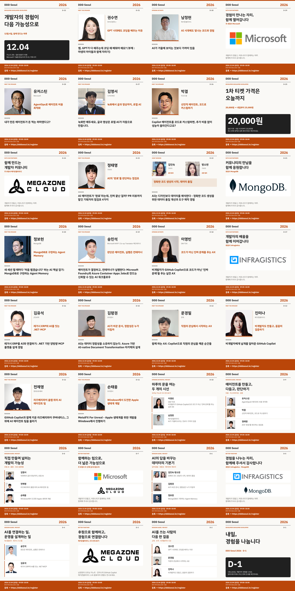

# DDD Seoul 2026 소셜미디어 게시 키트

**2026년 11월 2일–12월 3일, 매일 4채널에 게시할 초안**입니다. 공식 LinkedIn·Facebook·X는 Fedica에 예약했으며, Threads는 예약하지 않았습니다. 11월 6일 최신 발표 내용으로 갱신한 11개 날짜의 공식 3채널 예약 33건에는 본문·이미지·대체 텍스트 교체를 완료했습니다. 예약은 오전 9시 KST를 유지하며, 수정한 X 게시물 11건의 답글 권한은 Anyone입니다. 모든 카드와 초안의 CTA는 <https://dddseoul.kr/register>입니다.

[게시 달력](calendar.md)에서 날짜를 선택하면 해당 이미지와 공식 LinkedIn·Facebook·X, 개인 Threads 초안을 한꺼번에 볼 수 있습니다.

배포용 ZIP에서는 이미지·SVG·게시글을 바로 사용할 수 있습니다. 자동 재출력은 원본 발표자 문서와 자산을 읽으므로, 이 폴더를 원래 위치에 둔 저장소 체크아웃에서 실행하세요.



## 구성

| 항목 | 위치 | 수량 |
|---|---|---|
| 게시용 정사각형 PNG | `images` | 32개, 1080×1080, sRGB |
| 편집 가능한 SVG | `editable` | 32개, 사진·로고 포함 |
| 날짜별 게시글·이미지 대체 텍스트 | `posts` | 32문서, 채널별 초안 총 128개 |
| 게시 달력 | `calendar.md` | 32일, KST 기준 |
| 편집용 문구·일정 | `content.json` | 수작업 편집 원천 |
| 전체 데이터·완성 초안·출처 해시 | `campaign.json` | 자동 생성 |
| 카드 레이아웃·생성·검수 | `build.mjs` | 제작 전용, 웹사이트 빌드와 독립 |

발표자 17명의 첫 소개는 **개인 15장 + 김인숙·방소현 공동 1장**입니다. 파트너사 첫 소개 4장, 발표자 재소개 6장, 파트너사 재소개 3장, 참가 독려 3장으로 총 32장입니다.

모든 발표자의 첫 소개는 **11월 23일**에 끝나며, 재소개는 **11월 24일**부터 시작합니다.

| 날짜 | 발표자 재소개 | 세션 수 |
|---|---|---|
| 11/24 | 이영빈·남정현 | 오프닝 키노트 전용 |
| 11/25 | 유저스틴·박결·정태영 | 일반 3세션 |
| 11/26 | 김영서·전제영·손태웅 | 일반 3세션 |
| 11/28 | 김인숙·방소현 공동 발표, 김평권, 정보현 | 일반 3세션·4명 |
| 11/30 | 송민석·김유석 | 일반 2세션 |
| 12/02 | 권수연·문경필·진미나 | 일반 3세션 |

일반 세션 14개를 빠짐없이 나누었으며, 네 채널 각각에서 발표자 17명 모두를 재소개합니다. 주제 묶음은 편집상 구분이지 공식 트랙·발표 순서·동시 진행 시간표가 아닙니다.

메가존클라우드는 11/10·12/1 **단독 2회**, 11/27 **주 후원사 묶음 1회**로 총 3회 노출합니다. 참가 독려 전용일은 11/2·11/9·12/3이고, 다른 모든 날에도 등록 CTA가 있습니다.

## 게시하는 방법

1. `calendar.md`에서 게시 날짜를 선택합니다. 카드의 D-day는 그 날짜에 맞춰져 있으므로 다른 날에 재사용할 때는 다시 출력해야 합니다.
2. 해당 날짜 PNG를 첨부하고, 해당 채널의 본문만 복사합니다. 공식 3채널과 개인 Threads는 각각 다른 문구입니다.
3. 제공된 대체 텍스트를 이미지 설명에 넣습니다. 개인 Threads는 친근한 존댓말로 작성했습니다.
4. 게시 직전 발표 내용·소속·등록 가능 여부·판매 정책을 확인합니다. 이미지는 링크 자체를 클릭할 수 없으므로 **게시글 본문의 CTA도 반드시 유지**합니다.

X는 일반 계정의 280 **가중 문자** 기준으로 `twitter-text`를 통해 확인합니다. 한글·URL을 단순 글자 수로 계산하지 않습니다. Threads는 단일 게시물 500자 이내입니다.

## 수정과 재출력

Node.js와 npm, 한글 글꼴이 필요합니다. 카드의 제목·강조 문구에는 **IBM Plex Sans KR Bold**, 그 외 본문에는 **Pretendard Regular**를 사용합니다. 두 글꼴 파일은 기본적으로 Windows 사용자 글꼴 폴더에서 읽으며 저장소나 SVG에 포함하지 않습니다. SVG에는 편집 가능한 텍스트가 남아 있으므로 다른 컴퓨터에서 열 때도 두 글꼴을 설치해야 동일하게 보입니다. PNG는 글꼴 설치 없이 게시할 수 있습니다.

저장소 루트의 PowerShell에서:

```powershell
npm --prefix cardnews\2026 ci --no-audit --no-fund
node cardnews\2026\build.mjs
node cardnews\2026\build.mjs --check
```

`npm run build`, `npm run check`를 제작 폴더 안에서 실행해도 같은 결과입니다. 제작 의존성은 이 폴더에만 설치되며 기존 .NET 사이트에는 영향을 주지 않습니다.

기본 글꼴 파일은 `%LOCALAPPDATA%\Microsoft\Windows\Fonts\IBMPlexSansKR-Bold.ttf`와 `%LOCALAPPDATA%\Microsoft\Windows\Fonts\Pretendard-Regular.otf`입니다. 다른 글꼴 파일을 쓰려면 경로를 같은 PowerShell 프로세스에서 지정합니다. 제목·강조용 파일은 굵은 글꼴, 본문용 파일은 일반 글꼴이어야 하며 카드에서 사용하는 한글·영문·기호를 모두 지원해야 합니다.

```powershell
$env:DDD_FONT_BODY = 'C:\fonts\Pretendard-Regular.otf'
$env:DDD_FONT_EMPHASIS = 'C:\fonts\IBMPlexSansKR-Bold.ttf'
node cardnews\2026\build.mjs
```

- **문구·소개 날짜·재소개 묶음:** `content.json`을 수정합니다.
- **이름·소속·사진·정식 세션명:** `src\DDDSeoul\input\speakers`의 원문에서 읽습니다. 사진 경로는 원문을 그대로 따릅니다. 진미나 사진은 운영진 이미지 경로입니다.
- **디자인·글자 크기·줄바꿈·사진 배치:** `build.mjs`의 카드 함수에서 수정합니다. 글자가 영역을 넘거나 글꼴에 문자가 없으면 생성을 실패시킵니다.
- **편집 프로그램에서 개별 수정:** `editable`의 SVG를 사용합니다. 다만 자동 생성 명령은 SVG·PNG·게시글·달력을 다시 쓰므로, 계속 유지할 변경은 원천 데이터나 템플릿에도 반영해야 합니다.
- **파트너사 로고:** 기존 `theme\input\images\sponsors`의 원본 비율·색상을 유지합니다. 생성형 로고나 외부 인물 사진을 사용하지 않습니다.

`campaign.json`은 편집 원천이 아니라 완성 데이터입니다. `--check`는 원천과 생성물 일치, 이미지 규격, SVG→PNG 일치, 일정·커버리지·CTA·글자 수, 원본 파일 변경 여부를 확인합니다. 문구를 변경한 뒤에는 다시 생성하고 전체 미리보기와 해당 카드를 육안으로 확인하세요.

## 게시 전 반드시 확인할 항목

- **11월 6일 발표 내용 갱신:** 정태영·정보현·송민석·이영빈·전제영 님의 첫 소개와 관련 재소개, MongoDB 소개글을 최신 원문에 맞췄습니다. 이영빈 님의 키노트 제목·내용이 확정됐으며, 전제영 님의 문서·사진 경로는 `jeayoungjeon`입니다. Fedica 예약 교체 대상은 11/11·13·14·15·16·22·24·25·26·28·30이며, 공식 3채널 모두 반영했습니다. 저장된 이미지 33개는 로컬 1080×1080 PNG와 SHA-256이 일치합니다.
- 일반 티켓은 현재 웹사이트 기준 11/9까지 20,000원, 11/10–12/3은 25,000원입니다. 가격 관련 카드는 **11/9에만** 사용합니다. 실제 판매 상태·종료 시각·잔여석을 확인한 결과가 아니라 웹사이트의 안내 일정에 기반한 초안입니다.
- 12/3 글은 웹사이트에 안내된 판매 기간을 언급할 뿐, 특정 시각까지 구매 가능하거나 현장 등록이 가능하다고 보장하지 않습니다.
- 세션별 시간·방·경품·부스·식사·참가 혜택을 확인 없이 넣지 않았습니다.
- 외부 계정 태그를 추측하지 않았습니다. 공식 계정 태그를 추가하면 X 글자 수를 다시 확인해야 합니다.
- 사전에 작성한 초안이므로 판매 종료·행사 변경 등의 상황에서는 문구와 카드를 먼저 갱신하세요.
