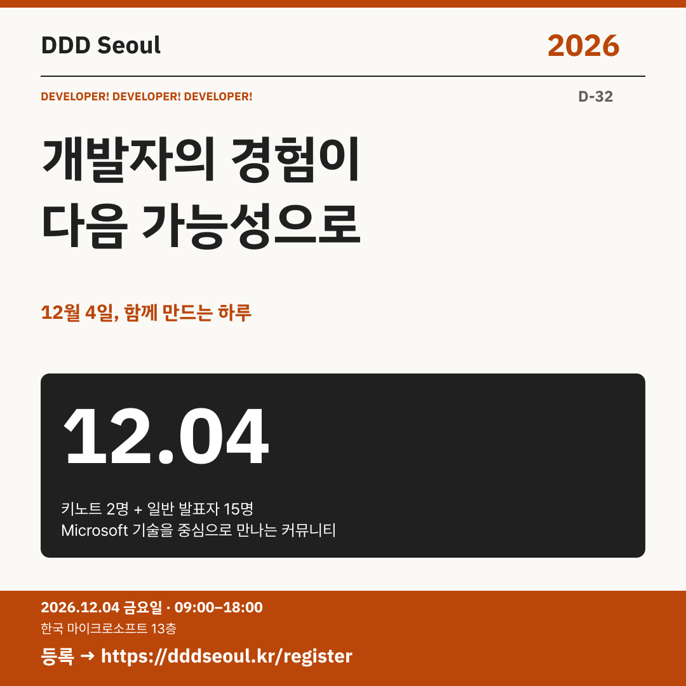

# 2026-11-02 · 개발자의 경험이 다음 가능성으로

유형: 참가 독려 · D-32 · 게시 기준: KST

편집 원본: [SVG](../editable/2026-11-02.svg)

## 이미지 대체 텍스트

DDD Seoul 2026. 개발자의 경험이 다음 가능성으로. 12월 4일, 함께 만드는 하루. 2026년 12월 4일 금요일 09:00–18:00, 한국 마이크로소프트 13층. 등록: https://dddseoul.kr/register

## LinkedIn · 공식 계정

Microsoft 기술을 중심으로, 개발자가 만들고 개발자가 함께하는 DDD Seoul 2026에 초대합니다.

키노트 연사 2명과 일반 발표자 15명이 함께합니다. AI 에이전트, .NET·MCP, 클라우드, 데이터, 조직의 AX까지 서로 다른 현장의 경험을 만나보세요.

2026.12.04(금) 09:00–18:00
한국 마이크로소프트 13층

참가 등록: https://dddseoul.kr/register

#DDDSeoul #DDDSeoul2026

## Facebook · 공식 계정

12월 4일 금요일, 개발자들과 경험을 나누는 하루를 계획해보세요.

키노트 연사 2명과 일반 발표자 15명이 함께합니다. AI 에이전트, .NET·MCP, 클라우드, 데이터, 조직의 AX까지 서로 다른 현장의 경험을 만나보세요.

12월 4일 금요일, 09:00–18:00
한국 마이크로소프트 13층에서 만나요.

참가 등록: https://dddseoul.kr/register

#DDDSeoul #DDDSeoul2026

## X · 공식 계정

DDD Seoul 2026에 초대합니다! 키노트 2명·일반 발표자 15명과 Microsoft 기술, AI, 개발 경험을 나눠요. 12/4(금) 한국 마이크로소프트 13층.

등록: https://dddseoul.kr/register

#DDDSeoul #DDDSeoul2026

## Threads · 개인 계정

이제 발표자와 파트너사가 모두 정해졌어요. 오늘부터 DDD Seoul 2026에서 만나게 될 이야기들을 하나씩 소개하려고 해요. 12월 4일, 함께 이야기 나눠요.

12/4(금), 한국 마이크로소프트 13층에서 함께 이야기 나눠요.
등록: https://dddseoul.kr/register

#DDDSeoul #DDDSeoul2026

## 게시 전 확인

32일 캠페인 시작

X 가중 문자: 189/280 · Threads: 188/500

초안입니다. 실제 게시·예약은 하지 않았습니다.
