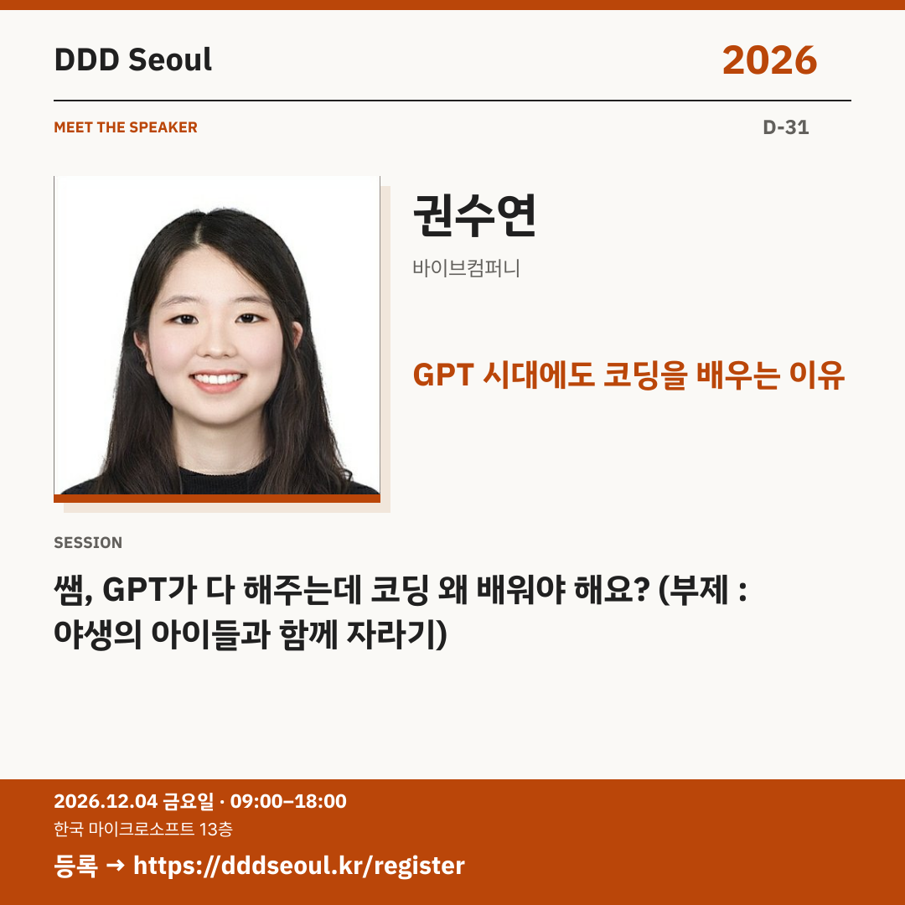

# 2026-11-03 · GPT 시대에도 코딩을 배우는 이유

유형: 발표자 첫 소개 · D-31 · 게시 기준: KST

편집 원본: [SVG](../editable/2026-11-03.svg)

## 이미지 대체 텍스트

DDD Seoul 2026. GPT 시대에도 코딩을 배우는 이유. 권수연: 쌤, GPT가 다 해주는데 코딩 왜 배워야 해요? (부제 : 야생의 아이들과 함께 자라기). 2026년 12월 4일 금요일 09:00–18:00, 한국 마이크로소프트 13층. 등록: https://dddseoul.kr/register

## LinkedIn · 공식 계정

“GPT가 다 해주는데 코딩 왜 배워야 해요?”

권수연 님은 개발 현장과 코딩 교실에서 겪은 변화를 연결합니다. AI와 일하는 방식, 학생을 가르치는 방식의 닮은 점과 차이를 통해 호기심·끈기·인내의 의미를 돌아봅니다.

권수연(바이브컴퍼니)
「쌤, GPT가 다 해주는데 코딩 왜 배워야 해요? (부제 : 야생의 아이들과 함께 자라기)」

2026.12.04(금) 09:00–18:00
한국 마이크로소프트 13층

참가 등록: https://dddseoul.kr/register

#DDDSeoul #DDDSeoul2026

## Facebook · 공식 계정

코딩을 배우는 이유를 묻는 아이에게 어떤 답을 해주고 싶으신가요?

권수연 님은 개발 현장과 코딩 교실에서 겪은 변화를 연결합니다. AI와 일하는 방식, 학생을 가르치는 방식의 닮은 점과 차이를 통해 호기심·끈기·인내의 의미를 돌아봅니다.

권수연(바이브컴퍼니)
「쌤, GPT가 다 해주는데 코딩 왜 배워야 해요? (부제 : 야생의 아이들과 함께 자라기)」

12월 4일 금요일, 09:00–18:00
한국 마이크로소프트 13층에서 만나요.

참가 등록: https://dddseoul.kr/register

#DDDSeoul #DDDSeoul2026

## X · 공식 계정

“쌤, GPT가 다 해주는데 코딩 왜 배워야 해요?” 권수연(바이브컴퍼니)이 회사와 코딩 교실에서 겪은 변화를 연결하며 호기심·끈기·인내를 이야기합니다.

등록: https://dddseoul.kr/register

#DDDSeoul #DDDSeoul2026

## Threads · 개인 계정

이 질문은 학생들만의 질문이 아닐 것 같아요. 권수연 님이 회사와 교실을 오가며 찾은 ‘코딩을 배우는 이유’를 함께 들어봐요.

12/4(금), 한국 마이크로소프트 13층에서 함께 이야기 나눠요.
등록: https://dddseoul.kr/register

#DDDSeoul #DDDSeoul2026

## 게시 전 확인

게시 직전 세션·소속·판매 상태를 확인.

X 가중 문자: 198/280 · Threads: 167/500

초안입니다. 실제 게시·예약은 하지 않았습니다.
