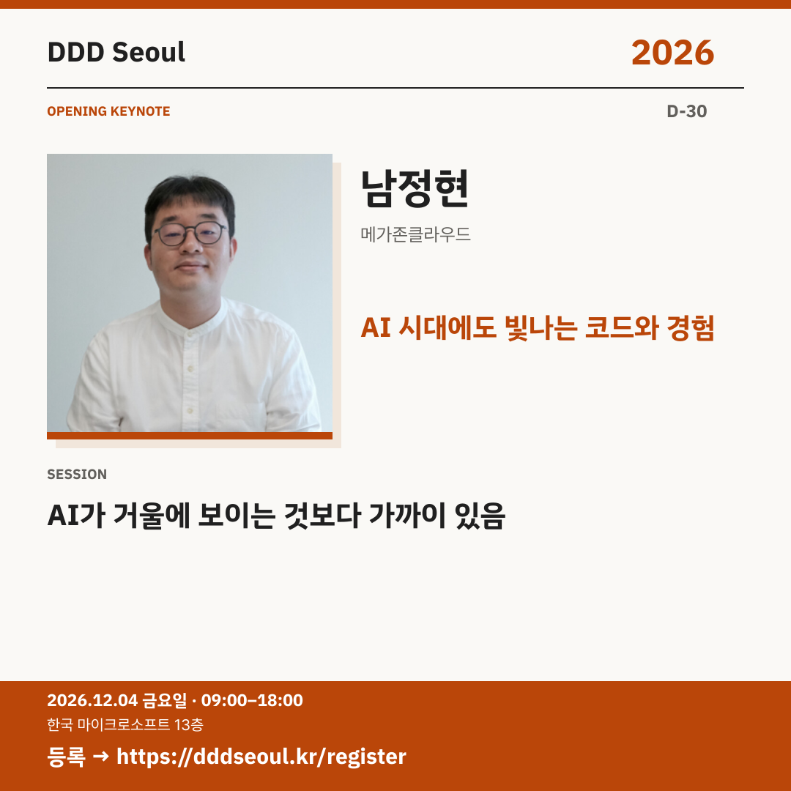

# 2026-11-04 · AI 시대에도 빛나는 코드와 경험

유형: 발표자 첫 소개 · D-30 · 게시 기준: KST

편집 원본: [SVG](../editable/2026-11-04.svg)

## 이미지 대체 텍스트

DDD Seoul 2026. AI 시대에도 빛나는 코드와 경험. 남정현: AI가 거울에 보이는 것보다 가까이 있음. 2026년 12월 4일 금요일 09:00–18:00, 한국 마이크로소프트 13층. 등록: https://dddseoul.kr/register

## LinkedIn · 공식 계정

AI 시대에, 지금까지 쌓은 코드와 경험은 더 중요해집니다.

남정현 님의 오프닝 키노트는 소프트웨어와 개발자의 가치, 코드와 AI가 만나는 이음매를 다룹니다. 새로운 도구를 쫓기 전에 이미 가진 경험의 의미를 다시 살펴보세요.

남정현(메가존클라우드)
「AI가 거울에 보이는 것보다 가까이 있음」

2026.12.04(금) 09:00–18:00
한국 마이크로소프트 13층

참가 등록: https://dddseoul.kr/register

#DDDSeoul #DDDSeoul2026

## Facebook · 공식 계정

AI가 멀게 느껴졌다면, 이미 쌓아 온 경험부터 다시 바라보세요.

남정현 님의 오프닝 키노트는 소프트웨어와 개발자의 가치, 코드와 AI가 만나는 이음매를 다룹니다. 새로운 도구를 쫓기 전에 이미 가진 경험의 의미를 다시 살펴보세요.

남정현(메가존클라우드)
「AI가 거울에 보이는 것보다 가까이 있음」

12월 4일 금요일, 09:00–18:00
한국 마이크로소프트 13층에서 만나요.

참가 등록: https://dddseoul.kr/register

#DDDSeoul #DDDSeoul2026

## X · 공식 계정

“AI가 거울에 보이는 것보다 가까이 있음” — 남정현(메가존클라우드) 오프닝 키노트. 코드와 경험의 가치, AI 시대 개발자의 역할을 함께 살펴봅니다.

등록: https://dddseoul.kr/register

#DDDSeoul #DDDSeoul2026

## Threads · 개인 계정

AI 시대라고 지금까지 쌓은 경험을 내려놓아야 하는 건 아니겠죠. 남정현 님의 키노트와 함께 이번 행사의 문을 열어보려고 해요.

12/4(금), 한국 마이크로소프트 13층에서 함께 이야기 나눠요.
등록: https://dddseoul.kr/register

#DDDSeoul #DDDSeoul2026

## 게시 전 확인

게시 직전 세션·소속·판매 상태를 확인.

X 가중 문자: 196/280 · Threads: 168/500

초안입니다. 실제 게시·예약은 하지 않았습니다.
