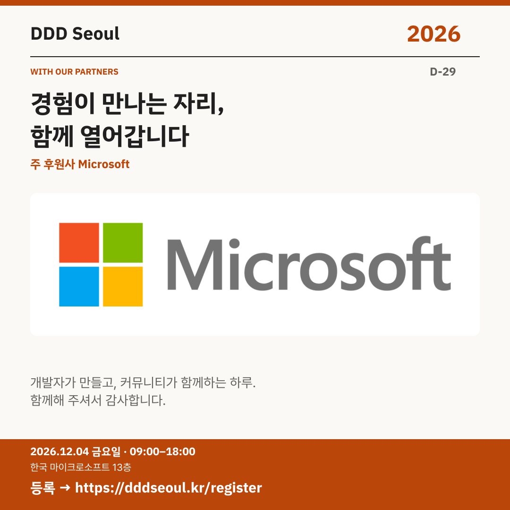

# 2026-11-05 · 경험이 만나는 자리, 함께 열어갑니다

유형: 파트너사 첫 소개 · D-29 · 게시 기준: KST

편집 원본: [SVG](../editable/2026-11-05.svg)

## 이미지 대체 텍스트

DDD Seoul 2026. 경험이 만나는 자리, 함께 열어갑니다. 주 후원사 Microsoft. 2026년 12월 4일 금요일 09:00–18:00, 한국 마이크로소프트 13층. 등록: https://dddseoul.kr/register

## LinkedIn · 공식 계정

DDD Seoul 2026의 주 후원사 Microsoft를 소개합니다.

DDD Seoul은 Microsoft 기술을 중심으로 경험을 나누는 커뮤니티 주도 개발자 컨퍼런스입니다. 행사를 함께하는 Microsoft에 감사드립니다.

2026.12.04(금) 09:00–18:00
한국 마이크로소프트 13층

참가 등록: https://dddseoul.kr/register

#DDDSeoul #DDDSeoul2026

## Facebook · 공식 계정

개발자가 경험을 나누는 하루에 Microsoft가 주 후원사로 함께합니다.

DDD Seoul은 Microsoft 기술을 중심으로 경험을 나누는 커뮤니티 주도 개발자 컨퍼런스입니다. 행사를 함께하는 Microsoft에 감사드립니다.

12월 4일 금요일, 09:00–18:00
한국 마이크로소프트 13층에서 만나요.

참가 등록: https://dddseoul.kr/register

#DDDSeoul #DDDSeoul2026

## X · 공식 계정

DDD Seoul 2026 주 후원사 Microsoft를 소개합니다. Microsoft 기술을 중심으로 개발자들이 경험을 나누는 하루에 함께해 주셔서 감사합니다.

등록: https://dddseoul.kr/register

#DDDSeoul #DDDSeoul2026

## Threads · 개인 계정

행사 준비에는 함께해 주시는 분들의 힘이 필요하죠. DDD Seoul 2026의 주 후원사 Microsoft를 소개하고 감사 인사를 전해요.

12/4(금), 한국 마이크로소프트 13층에서 함께 이야기 나눠요.
등록: https://dddseoul.kr/register

#DDDSeoul #DDDSeoul2026

## 게시 전 확인

게시 직전 세션·소속·판매 상태를 확인.

X 가중 문자: 188/280 · Threads: 175/500

초안입니다. 실제 게시·예약은 하지 않았습니다.
