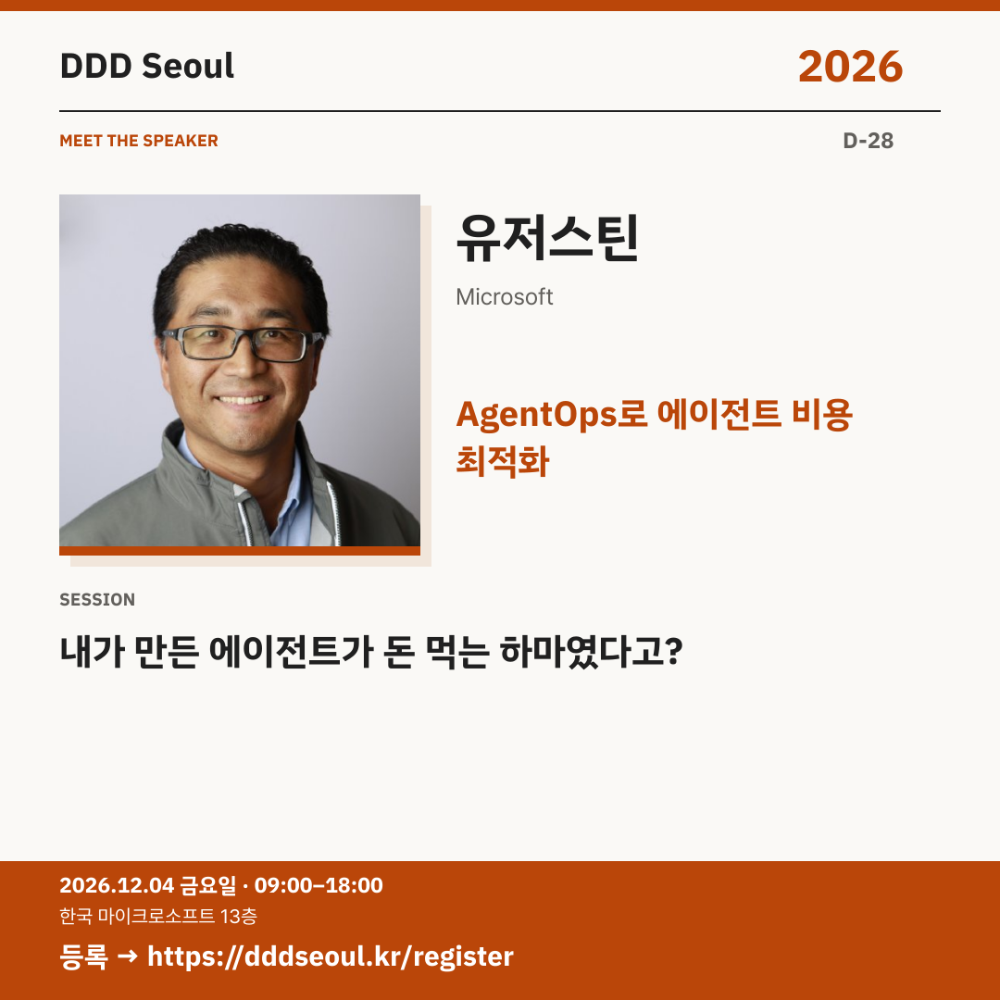

# 2026-11-06 · AgentOps로 에이전트 비용 최적화

유형: 발표자 첫 소개 · D-28 · 게시 기준: KST

편집 원본: [SVG](../editable/2026-11-06.svg)

## 이미지 대체 텍스트

DDD Seoul 2026. AgentOps로 에이전트 비용 최적화. 유저스틴: 내가 만든 에이전트가 돈 먹는 하마였다고?. 2026년 12월 4일 금요일 09:00–18:00, 한국 마이크로소프트 13층. 등록: https://dddseoul.kr/register

## LinkedIn · 공식 계정

일은 잘하는 AI 에이전트, 비용까지 잘 관리하고 있나요?

유저스틴 님은 AgentOps 관점에서 상황 진단, 모델 최적화, 에이전트 최적화로 이어지는 힐클라이밍 기법을 다룹니다. 모델 선택만으로 설명하기 어려운 에이전트 비용을 함께 들여다봅니다.

유저스틴(Microsoft)
「내가 만든 에이전트가 돈 먹는 하마였다고?」

2026.12.04(금) 09:00–18:00
한국 마이크로소프트 13층

참가 등록: https://dddseoul.kr/register

#DDDSeoul #DDDSeoul2026

## Facebook · 공식 계정

에이전트가 일을 잘해서 좋아했는데, 비용을 보고 놀란 적 있나요?

유저스틴 님은 AgentOps 관점에서 상황 진단, 모델 최적화, 에이전트 최적화로 이어지는 힐클라이밍 기법을 다룹니다. 모델 선택만으로 설명하기 어려운 에이전트 비용을 함께 들여다봅니다.

유저스틴(Microsoft)
「내가 만든 에이전트가 돈 먹는 하마였다고?」

12월 4일 금요일, 09:00–18:00
한국 마이크로소프트 13층에서 만나요.

참가 등록: https://dddseoul.kr/register

#DDDSeoul #DDDSeoul2026

## X · 공식 계정

내가 만든 에이전트가 돈 먹는 하마였다고? 유저스틴(Microsoft)과 AgentOps 관점의 진단·모델 최적화·에이전트 최적화를 살펴보세요.

등록: https://dddseoul.kr/register

#DDDSeoul #DDDSeoul2026

## Threads · 개인 계정

에이전트를 만드는 것만큼 운영 비용을 이해하는 일도 중요하죠. 이번에는 제가 AgentOps 관점에서 비용 최적화 이야기를 나눕니다.

12/4(금), 한국 마이크로소프트 13층에서 함께 이야기 나눠요.
등록: https://dddseoul.kr/register

#DDDSeoul #DDDSeoul2026

## 게시 전 확인

게시 직전 세션·소속·판매 상태를 확인.

X 가중 문자: 181/280 · Threads: 171/500

초안입니다. 실제 게시·예약은 하지 않았습니다.
