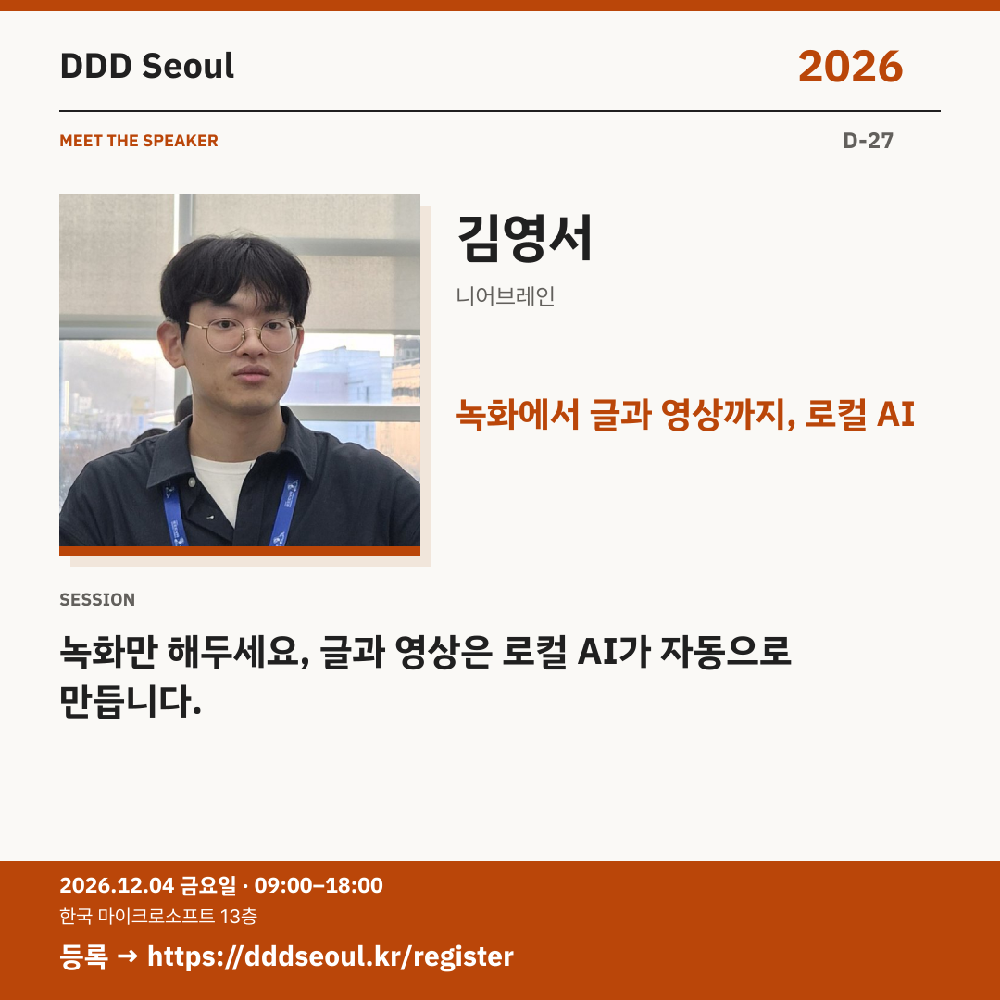

# 2026-11-07 · 녹화에서 글과 영상까지, 로컬 AI

유형: 발표자 첫 소개 · D-27 · 게시 기준: KST

편집 원본: [SVG](../editable/2026-11-07.svg)

## 이미지 대체 텍스트

DDD Seoul 2026. 녹화에서 글과 영상까지, 로컬 AI. 김영서: 녹화만 해두세요, 글과 영상은 로컬 AI가 자동으로 만듭니다.. 2026년 12월 4일 금요일 09:00–18:00, 한국 마이크로소프트 13층. 등록: https://dddseoul.kr/register

## LinkedIn · 공식 계정

녹화한 콘텐츠, 글과 영상으로 다시 활용할 수 있을까요?

김영서 님은 로컬 AI로 녹화 자료에서 글과 영상을 만드는 이야기를 나눕니다. 콘텐츠 제작에 AI를 활용하고 싶은 분들이 눈여겨볼 세션입니다.

김영서(니어브레인)
「녹화만 해두세요, 글과 영상은 로컬 AI가 자동으로 만듭니다.」

2026.12.04(금) 09:00–18:00
한국 마이크로소프트 13층

참가 등록: https://dddseoul.kr/register

#DDDSeoul #DDDSeoul2026

## Facebook · 공식 계정

녹화는 해뒀는데 다음 작업이 막막하다면, 이 세션을 살펴보세요.

김영서 님은 로컬 AI로 녹화 자료에서 글과 영상을 만드는 이야기를 나눕니다. 콘텐츠 제작에 AI를 활용하고 싶은 분들이 눈여겨볼 세션입니다.

김영서(니어브레인)
「녹화만 해두세요, 글과 영상은 로컬 AI가 자동으로 만듭니다.」

12월 4일 금요일, 09:00–18:00
한국 마이크로소프트 13층에서 만나요.

참가 등록: https://dddseoul.kr/register

#DDDSeoul #DDDSeoul2026

## X · 공식 계정

“녹화만 해두세요, 글과 영상은 로컬 AI가 자동으로 만듭니다.” 김영서(니어브레인)의 로컬 AI 활용 이야기를 DDD Seoul에서 만나세요.

등록: https://dddseoul.kr/register

#DDDSeoul #DDDSeoul2026

## Threads · 개인 계정

녹화만 해둔 자료를 글과 영상으로 이어갈 수 있다면 어떨까요? 김영서 님이 준비한 로컬 AI 활용 이야기를 소개해요.

12/4(금), 한국 마이크로소프트 13층에서 함께 이야기 나눠요.
등록: https://dddseoul.kr/register

#DDDSeoul #DDDSeoul2026

## 게시 전 확인

게시 직전 세션·소속·판매 상태를 확인.

X 가중 문자: 182/280 · Threads: 162/500

초안입니다. 실제 게시·예약은 하지 않았습니다.
