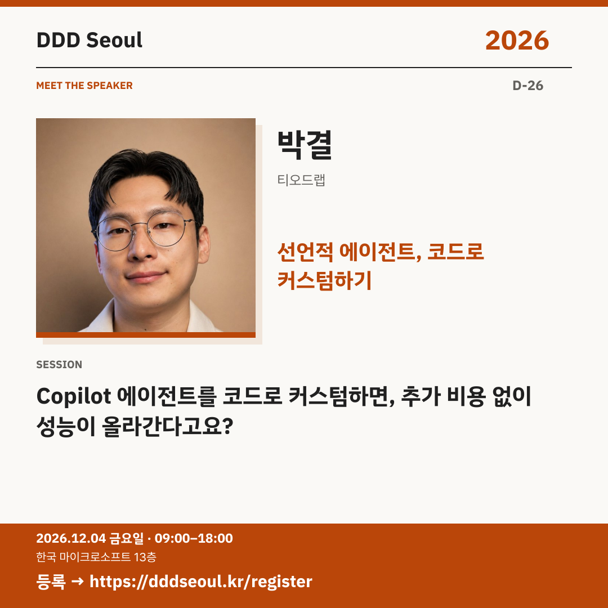

# 2026-11-08 · 선언적 에이전트, 코드로 커스텀하기

유형: 발표자 첫 소개 · D-26 · 게시 기준: KST

편집 원본: [SVG](../editable/2026-11-08.svg)

## 이미지 대체 텍스트

DDD Seoul 2026. 선언적 에이전트, 코드로 커스텀하기. 박결: Copilot 에이전트를 코드로 커스텀하면, 추가 비용 없이 성능이 올라간다고요?. 2026년 12월 4일 금요일 09:00–18:00, 한국 마이크로소프트 13층. 등록: https://dddseoul.kr/register

## LinkedIn · 공식 계정

에이전트 제작 화면 밖에는 어떤 가능성이 있을까요?

박결 님은 선언적 에이전트의 manifest.json과 declarativeAgent.json을 직접 수정하는 방법을 소개합니다. Agent Builder 화면에 보이는 기능을 넘어 Copilot 에이전트를 커스터마이징하는 접근을 살펴봅니다.

박결(티오드랩)
「Copilot 에이전트를 코드로 커스텀하면, 추가 비용 없이 성능이 올라간다고요?」

2026.12.04(금) 09:00–18:00
한국 마이크로소프트 13층

참가 등록: https://dddseoul.kr/register

#DDDSeoul #DDDSeoul2026

## Facebook · 공식 계정

Agent Builder에서 원하는 기능이 보이지 않았다면?

박결 님은 선언적 에이전트의 manifest.json과 declarativeAgent.json을 직접 수정하는 방법을 소개합니다. Agent Builder 화면에 보이는 기능을 넘어 Copilot 에이전트를 커스터마이징하는 접근을 살펴봅니다.

박결(티오드랩)
「Copilot 에이전트를 코드로 커스텀하면, 추가 비용 없이 성능이 올라간다고요?」

12월 4일 금요일, 09:00–18:00
한국 마이크로소프트 13층에서 만나요.

참가 등록: https://dddseoul.kr/register

#DDDSeoul #DDDSeoul2026

## X · 공식 계정

Copilot 에이전트, 화면에서 만드는 게 전부일까요? 박결(티오드랩)이 manifest.json·declarativeAgent.json을 직접 고치는 커스터마이징 방법을 소개합니다.

등록: https://dddseoul.kr/register

#DDDSeoul #DDDSeoul2026

## Threads · 개인 계정

만드는 화면에서 보이는 기능이 전부는 아닐 수 있어요. 박결 님이 선언적 에이전트를 코드로 커스텀하는 방법을 소개합니다.

12/4(금), 한국 마이크로소프트 13층에서 함께 이야기 나눠요.
등록: https://dddseoul.kr/register

#DDDSeoul #DDDSeoul2026

## 게시 전 확인

게시 직전 세션·소속·판매 상태를 확인.

X 가중 문자: 203/280 · Threads: 164/500

초안입니다. 실제 게시·예약은 하지 않았습니다.
