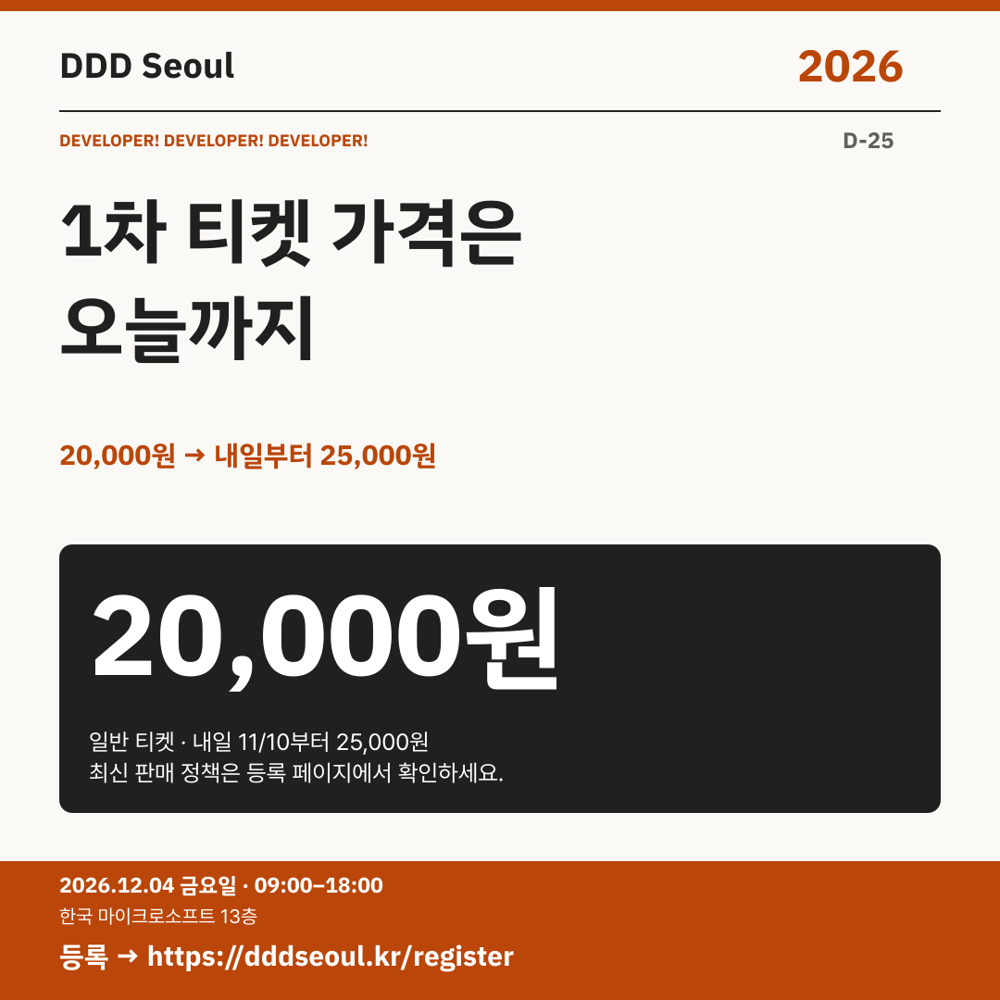

# 2026-11-09 · 1차 티켓 가격은 오늘까지

유형: 참가 독려 · D-25 · 게시 기준: KST

편집 원본: [SVG](../editable/2026-11-09.svg)

## 이미지 대체 텍스트

DDD Seoul 2026. 1차 티켓 가격은 오늘까지. 20,000원 → 내일부터 25,000원. 2026년 12월 4일 금요일 09:00–18:00, 한국 마이크로소프트 13층. 등록: https://dddseoul.kr/register

## LinkedIn · 공식 계정

DDD Seoul 2026 일반 티켓의 1차 판매 기간은 오늘 11월 9일까지입니다.

웹사이트 안내 기준 일반 티켓은 오늘까지 20,000원, 11월 10일부터 12월 3일까지는 25,000원입니다. 참가를 계획하고 계셨다면 판매 기간과 등록 페이지의 최신 정책을 확인해 주세요.

2026.12.04(금) 09:00–18:00
한국 마이크로소프트 13층

참가 등록: https://dddseoul.kr/register

#DDDSeoul #DDDSeoul2026

## Facebook · 공식 계정

참가를 고민하고 계셨다면 오늘의 티켓 판매 안내를 확인해 주세요.

웹사이트 안내 기준 일반 티켓은 오늘까지 20,000원, 11월 10일부터 12월 3일까지는 25,000원입니다. 참가를 계획하고 계셨다면 판매 기간과 등록 페이지의 최신 정책을 확인해 주세요.

12월 4일 금요일, 09:00–18:00
한국 마이크로소프트 13층에서 만나요.

참가 등록: https://dddseoul.kr/register

#DDDSeoul #DDDSeoul2026

## X · 공식 계정

DDD Seoul 일반 티켓 1차 판매는 오늘(11/9)까지 20,000원. 내일(11/10)부터는 25,000원입니다. 참가 계획이 있다면 등록 페이지의 최신 판매 안내를 확인해 주세요.

등록: https://dddseoul.kr/register

#DDDSeoul #DDDSeoul2026

## Threads · 개인 계정

행사 이야기를 이어가기 전에 티켓 일정도 알려드릴게요. 웹사이트 기준 1차 일반 티켓은 오늘까지 20,000원이고, 내일부터는 25,000원이에요. 등록 페이지의 최신 안내를 확인해 주세요.

12/4(금), 한국 마이크로소프트 13층에서 함께 이야기 나눠요.
등록: https://dddseoul.kr/register

#DDDSeoul #DDDSeoul2026

## 게시 전 확인

가격·판매 일정은 게시 직전 등록 페이지에서 재확인. 마감 시각·잔여석 단정 금지.

X 가중 문자: 210/280 · Threads: 203/500

초안입니다. 실제 게시·예약은 하지 않았습니다.
