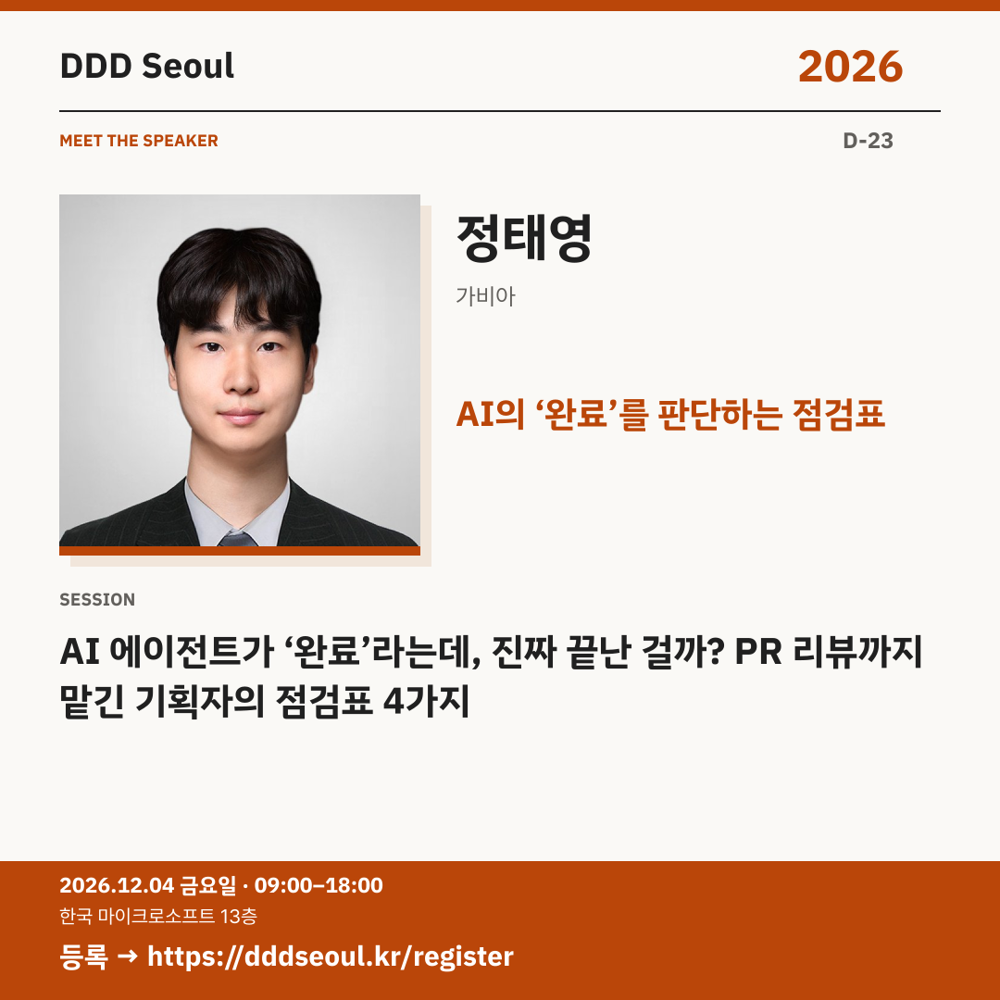

# 2026-11-11 · AI의 ‘완료’를 판단하는 점검표

유형: 발표자 첫 소개 · D-23 · 게시 기준: KST

편집 원본: [SVG](../editable/2026-11-11.svg)

## 이미지 대체 텍스트

DDD Seoul 2026. AI의 ‘완료’를 판단하는 점검표. 정태영: AI 에이전트가 ‘완료’라는데, 진짜 끝난 걸까? PR 리뷰까지 맡긴 기획자의 점검표 4가지. 2026년 12월 4일 금요일 09:00–18:00, 한국 마이크로소프트 13층. 등록: https://dddseoul.kr/register

## LinkedIn · 공식 계정

AI 에이전트가 ‘완료’라는데, 진짜 끝난 걸까요?

정태영 님은 기획자로서 AI 에이전트에 개발·검수·운영을 맡긴 사례를 공유합니다. 완료 조건, 확인 근거, 판단 권한, 인계 기록이라는 네 가지 기준을 실제 사건으로 짚습니다.

정태영(가비아)
「AI 에이전트가 ‘완료’라는데, 진짜 끝난 걸까? PR 리뷰까지 맡긴 기획자의 점검표 4가지」

2026.12.04(금) 09:00–18:00
한국 마이크로소프트 13층

참가 등록: https://dddseoul.kr/register

#DDDSeoul #DDDSeoul2026

## Facebook · 공식 계정

자동 검사가 통과했는데도 사용자 화면은 달랐다면, 무엇을 확인해야 할까요?

정태영 님은 기획자로서 AI 에이전트에 개발·검수·운영을 맡긴 사례를 공유합니다. 완료 조건, 확인 근거, 판단 권한, 인계 기록이라는 네 가지 기준을 실제 사건으로 짚습니다.

정태영(가비아)
「AI 에이전트가 ‘완료’라는데, 진짜 끝난 걸까? PR 리뷰까지 맡긴 기획자의 점검표 4가지」

12월 4일 금요일, 09:00–18:00
한국 마이크로소프트 13층에서 만나요.

참가 등록: https://dddseoul.kr/register

#DDDSeoul #DDDSeoul2026

## X · 공식 계정

AI 에이전트가 ‘완료’라는데, 진짜 끝난 걸까? 정태영(가비아)이 PR 리뷰까지 맡긴 기획자의 점검표 4가지 — 완료 조건·확인 근거·판단 권한·인계 기록을 공유합니다.

등록: https://dddseoul.kr/register

#DDDSeoul #DDDSeoul2026

## Threads · 개인 계정

‘완료했어요’라는 한마디만으로는 부족할 때가 있죠. 정태영 님이 실제 서비스 운영에서 정리한 네 가지 점검 기준을 함께 들어보면 좋겠어요.

12/4(금), 한국 마이크로소프트 13층에서 함께 이야기 나눠요.
등록: https://dddseoul.kr/register

#DDDSeoul #DDDSeoul2026

## 게시 전 확인

게시 직전 세션·소속·판매 상태를 확인.

X 가중 문자: 211/280 · Threads: 174/500

초안입니다. 실제 게시·예약은 하지 않았습니다.
