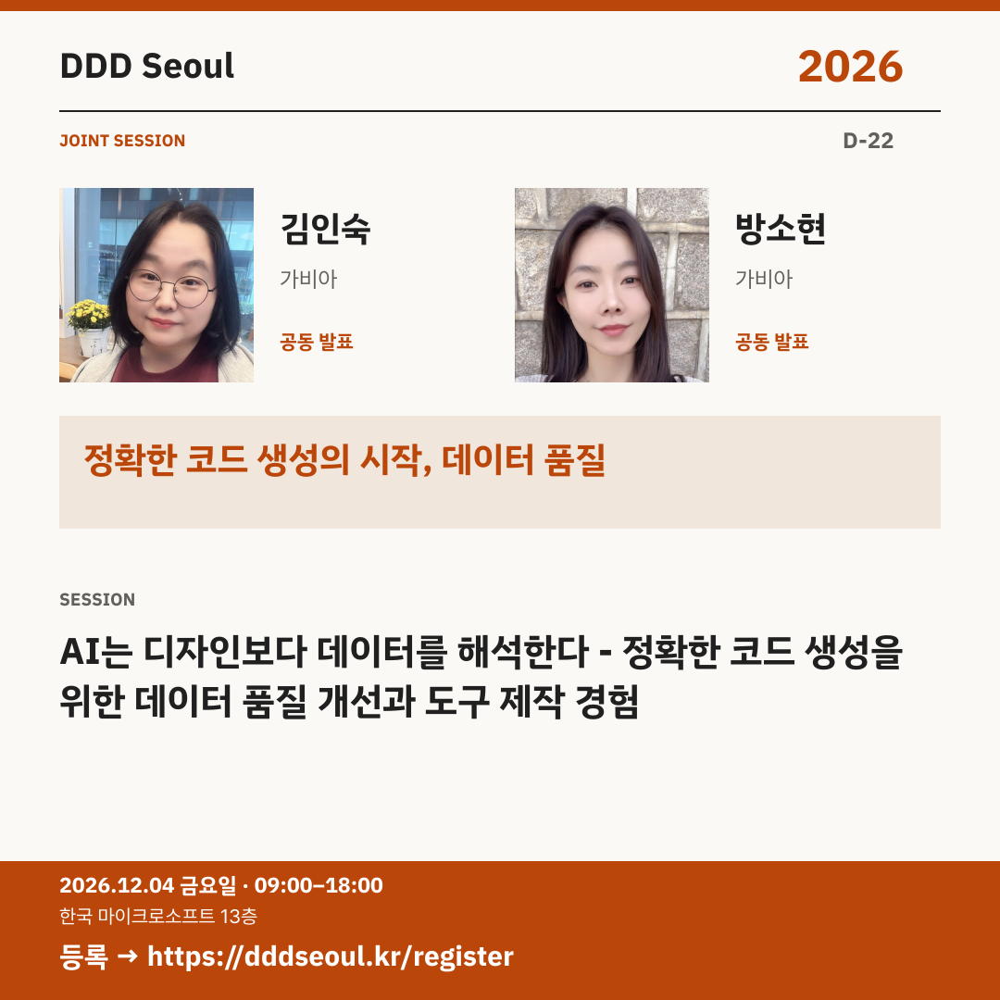

# 2026-11-12 · 정확한 코드 생성의 시작, 데이터 품질

유형: 발표자 첫 소개 · D-22 · 게시 기준: KST

편집 원본: [SVG](../editable/2026-11-12.svg)

## 이미지 대체 텍스트

DDD Seoul 2026. 정확한 코드 생성의 시작, 데이터 품질. 김인숙·방소현: AI는 디자인보다 데이터를 해석한다 - 정확한 코드 생성을 위한 데이터 품질 개선과 도구 제작 경험. 2026년 12월 4일 금요일 09:00–18:00, 한국 마이크로소프트 13층. 등록: https://dddseoul.kr/register

## LinkedIn · 공식 계정

AI의 코드 생성 오류, 모델보다 입력 데이터를 먼저 봐야 한다면?

가비아의 김인숙·방소현 님이 함께 발표합니다. 디자인 데이터를 AI가 일관되게 해석하도록 도구를 만들고 데이터 품질을 개선한 경험을 한 세션에서 공유합니다.

김인숙(가비아)·방소현(가비아)
「AI는 디자인보다 데이터를 해석한다 - 정확한 코드 생성을 위한 데이터 품질 개선과 도구 제작 경험」

2026.12.04(금) 09:00–18:00
한국 마이크로소프트 13층

참가 등록: https://dddseoul.kr/register

#DDDSeoul #DDDSeoul2026

## Facebook · 공식 계정

디자인을 코드로 바꾸는 AI가 자꾸 다른 답을 낸다면, 입력부터 살펴볼까요?

가비아의 김인숙·방소현 님이 함께 발표합니다. 디자인 데이터를 AI가 일관되게 해석하도록 도구를 만들고 데이터 품질을 개선한 경험을 한 세션에서 공유합니다.

김인숙(가비아)·방소현(가비아)
「AI는 디자인보다 데이터를 해석한다 - 정확한 코드 생성을 위한 데이터 품질 개선과 도구 제작 경험」

12월 4일 금요일, 09:00–18:00
한국 마이크로소프트 13층에서 만나요.

참가 등록: https://dddseoul.kr/register

#DDDSeoul #DDDSeoul2026

## X · 공식 계정

김인숙·방소현(가비아) 공동 발표: AI는 디자인보다 데이터를 해석한다. 정확한 코드 생성을 위해 디자인 데이터 품질을 개선하고 도구를 만든 경험을 만나세요.

등록: https://dddseoul.kr/register

#DDDSeoul #DDDSeoul2026

## Threads · 개인 계정

이번에는 두 분을 함께 소개해요. 김인숙·방소현 님은 AI가 디자인 데이터를 더 일관되게 읽도록 도구를 만들고 개선한 경험을 나눕니다.

12/4(금), 한국 마이크로소프트 13층에서 함께 이야기 나눠요.
등록: https://dddseoul.kr/register

#DDDSeoul #DDDSeoul2026

## 게시 전 확인

게시 직전 세션·소속·판매 상태를 확인.

X 가중 문자: 206/280 · Threads: 172/500

초안입니다. 실제 게시·예약은 하지 않았습니다.
