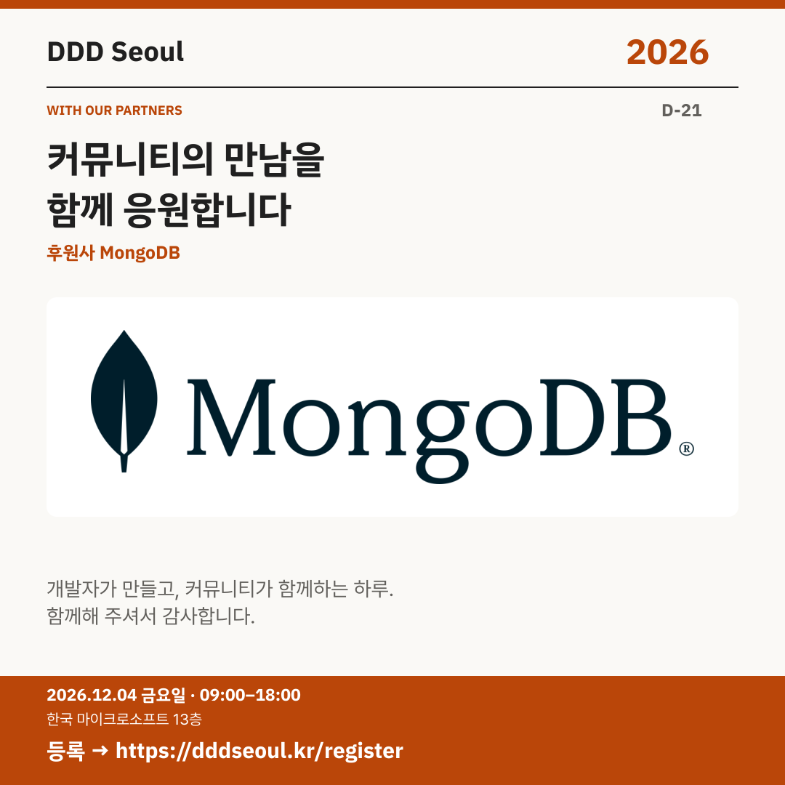

# 2026-11-13 · 커뮤니티의 만남을 함께 응원합니다

유형: 파트너사 첫 소개 · D-21 · 게시 기준: KST

편집 원본: [SVG](../editable/2026-11-13.svg)

## 이미지 대체 텍스트

DDD Seoul 2026. 커뮤니티의 만남을 함께 응원합니다. 후원사 MongoDB. 2026년 12월 4일 금요일 09:00–18:00, 한국 마이크로소프트 13층. 등록: https://dddseoul.kr/register

## LinkedIn · 공식 계정

DDD Seoul 2026의 후원사 MongoDB를 소개합니다.

새로운 기술과 실제 개발 경험을 나누는 자리에 함께해 주셔서 감사합니다. 이번 행사에서는 MongoDB 소속 정보현 님의 Agent Memory 설계·구현 세션도 만날 수 있습니다.

2026.12.04(금) 09:00–18:00
한국 마이크로소프트 13층

참가 등록: https://dddseoul.kr/register

#DDDSeoul #DDDSeoul2026

## Facebook · 공식 계정

후원사 MongoDB가 DDD Seoul 2026에 함께합니다. 내일은 정보현 님의 세션도 소개할게요.

새로운 기술과 실제 개발 경험을 나누는 자리에 함께해 주셔서 감사합니다. 이번 행사에서는 MongoDB 소속 정보현 님의 Agent Memory 설계·구현 세션도 만날 수 있습니다.

12월 4일 금요일, 09:00–18:00
한국 마이크로소프트 13층에서 만나요.

참가 등록: https://dddseoul.kr/register

#DDDSeoul #DDDSeoul2026

## X · 공식 계정

DDD Seoul 2026 후원사 MongoDB에 감사드립니다. 정보현 님의 MongoDB 기반 Agent Memory 설계·구현 세션도 함께 만나보세요.

등록: https://dddseoul.kr/register

#DDDSeoul #DDDSeoul2026

## Threads · 개인 계정

함께해 주시는 후원사 MongoDB에 감사드려요. 내일 소개할 정보현 님은 Interview Coach 예제를 바탕으로 MongoDB로 에이전트 메모리를 구현하는 이야기를 준비하고 있어요.

12/4(금), 한국 마이크로소프트 13층에서 함께 이야기 나눠요.
등록: https://dddseoul.kr/register

#DDDSeoul #DDDSeoul2026

## 게시 전 확인

게시 직전 세션·소속·판매 상태를 확인.

X 가중 문자: 173/280 · Threads: 202/500

초안입니다. 실제 게시·예약은 하지 않았습니다.
