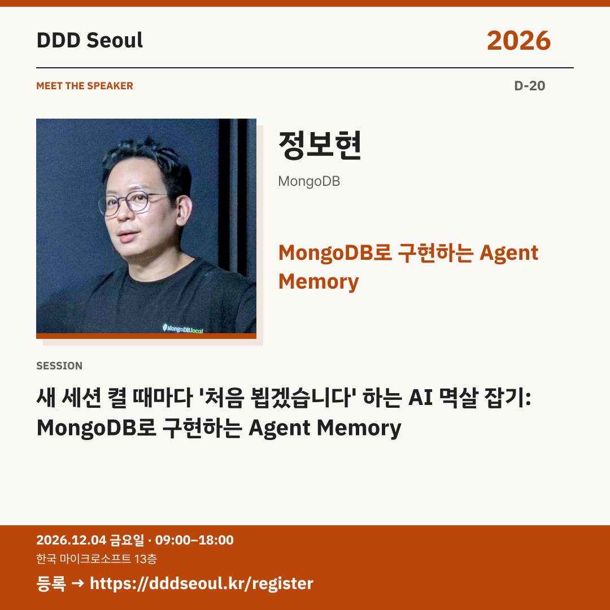

# 2026-11-14 · MongoDB로 구현하는 Agent Memory

유형: 발표자 첫 소개 · D-20 · 게시 기준: KST

편집 원본: [SVG](../editable/2026-11-14.svg)

## 이미지 대체 텍스트

DDD Seoul 2026. MongoDB로 구현하는 Agent Memory. 정보현: 새 세션 켤 때마다 '처음 뵙겠습니다' 하는 AI 멱살 잡기: MongoDB로 구현하는 Agent Memory. 2026년 12월 4일 금요일 09:00–18:00, 한국 마이크로소프트 13층. 등록: https://dddseoul.kr/register

## LinkedIn · 공식 계정

새 세션마다 ‘처음 뵙겠습니다’ 하는 AI, 기억을 설계해볼까요?

정보현 님은 Interview Coach 예제를 출발점으로 에이전트 메모리를 MongoDB로 구현합니다. 장단기 메모리 유형과 생애주기 관리를 짚고, MongoDB for VS Code 확장의 MCP로 DB를 실시간 탐색하는 흐름까지 살펴봅니다.

정보현(MongoDB)
「새 세션 켤 때마다 '처음 뵙겠습니다' 하는 AI 멱살 잡기: MongoDB로 구현하는 Agent Memory」

2026.12.04(금) 09:00–18:00
한국 마이크로소프트 13층

참가 등록: https://dddseoul.kr/register

#DDDSeoul #DDDSeoul2026

## Facebook · 공식 계정

에이전트가 이전 대화를 기억하려면, 어떤 메모리 구조가 필요할까요?

정보현 님은 Interview Coach 예제를 출발점으로 에이전트 메모리를 MongoDB로 구현합니다. 장단기 메모리 유형과 생애주기 관리를 짚고, MongoDB for VS Code 확장의 MCP로 DB를 실시간 탐색하는 흐름까지 살펴봅니다.

정보현(MongoDB)
「새 세션 켤 때마다 '처음 뵙겠습니다' 하는 AI 멱살 잡기: MongoDB로 구현하는 Agent Memory」

12월 4일 금요일, 09:00–18:00
한국 마이크로소프트 13층에서 만나요.

참가 등록: https://dddseoul.kr/register

#DDDSeoul #DDDSeoul2026

## X · 공식 계정

새 세션 켤 때마다 ‘처음 뵙겠습니다’ 하는 AI 멱살 잡기! 정보현(MongoDB)과 Interview Coach의 Agent Memory를 구현하고, 장단기 메모리·생애주기 관리·MCP 탐색을 살펴보세요.

등록: https://dddseoul.kr/register

#DDDSeoul #DDDSeoul2026

## Threads · 개인 계정

새 세션을 열 때마다 처음 만난 것처럼 말하는 AI, 익숙하신가요? 정보현 님이 Interview Coach 예제의 메모리를 MongoDB로 구현하며 장단기 메모리와 생애주기 관리 이야기를 나눕니다.

12/4(금), 한국 마이크로소프트 13층에서 함께 이야기 나눠요.
등록: https://dddseoul.kr/register

#DDDSeoul #DDDSeoul2026

## 게시 전 확인

게시 직전 세션·소속·판매 상태를 확인.

X 가중 문자: 222/280 · Threads: 208/500

초안입니다. 실제 게시·예약은 하지 않았습니다.
