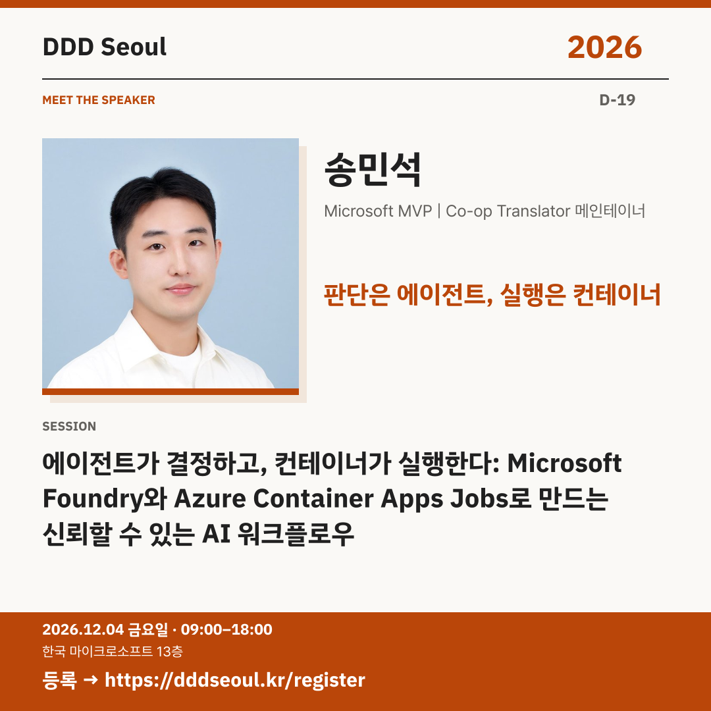

# 2026-11-15 · 판단은 에이전트, 실행은 컨테이너

유형: 발표자 첫 소개 · D-19 · 게시 기준: KST

편집 원본: [SVG](../editable/2026-11-15.svg)

## 이미지 대체 텍스트

DDD Seoul 2026. 판단은 에이전트, 실행은 컨테이너. 송민석: 에이전트가 결정하고, 컨테이너가 실행한다: Microsoft Foundry와 Azure Container Apps Jobs로 만드는 신뢰할 수 있는 AI 워크플로우. 2026년 12월 4일 금요일 09:00–18:00, 한국 마이크로소프트 13층. 등록: https://dddseoul.kr/register

## LinkedIn · 공식 계정

에이전트에게 판단과 실행의 신뢰성을 모두 맡겨도 될까요?

송민석 님은 Localizeflow 운영 경험을 바탕으로 기존 자동화와 AI 에이전트를 선택하는 기준을 살펴봅니다. Microsoft Foundry로 작업을 판단하고 Azure Container Apps Jobs로 격리된 실행을 맡기는 구조와, 안정적인 워크플로를 위한 기술 선택 기준을 공유합니다.

송민석(Microsoft MVP | Co-op Translator 메인테이너)
「에이전트가 결정하고, 컨테이너가 실행한다: Microsoft Foundry와 Azure Container Apps Jobs로 만드는 신뢰할 수 있는 AI 워크플로우」

2026.12.04(금) 09:00–18:00
한국 마이크로소프트 13층

참가 등록: https://dddseoul.kr/register

#DDDSeoul #DDDSeoul2026

## Facebook · 공식 계정

자동화로 충분한 일과 에이전트의 판단이 필요한 일, 어떻게 나눌까요?

송민석 님은 Localizeflow 운영 경험을 바탕으로 기존 자동화와 AI 에이전트를 선택하는 기준을 살펴봅니다. Microsoft Foundry로 작업을 판단하고 Azure Container Apps Jobs로 격리된 실행을 맡기는 구조와, 안정적인 워크플로를 위한 기술 선택 기준을 공유합니다.

송민석(Microsoft MVP | Co-op Translator 메인테이너)
「에이전트가 결정하고, 컨테이너가 실행한다: Microsoft Foundry와 Azure Container Apps Jobs로 만드는 신뢰할 수 있는 AI 워크플로우」

12월 4일 금요일, 09:00–18:00
한국 마이크로소프트 13층에서 만나요.

참가 등록: https://dddseoul.kr/register

#DDDSeoul #DDDSeoul2026

## X · 공식 계정

송민석의 AI 워크플로우: 판단은 Microsoft Foundry, 실행은 Azure Container Apps Jobs. Localizeflow 운영 경험으로 자동화·에이전트의 선택 기준과 역할 분리의 장점을 살펴봅니다.

등록: https://dddseoul.kr/register

#DDDSeoul #DDDSeoul2026

## Threads · 개인 계정

에이전트가 결정하는 일과 실제 작업을 실행하는 일을 나누면 무엇이 달라질까요? 송민석 님이 Localizeflow 운영 경험으로 자동화·에이전트의 선택 기준과 역할을 나누는 설계를 소개해요.

12/4(금), 한국 마이크로소프트 13층에서 함께 이야기 나눠요.
등록: https://dddseoul.kr/register

#DDDSeoul #DDDSeoul2026

## 게시 전 확인

게시 직전 세션·소속·판매 상태를 확인.

X 가중 문자: 227/280 · Threads: 203/500

초안입니다. 실제 게시·예약은 하지 않았습니다.
