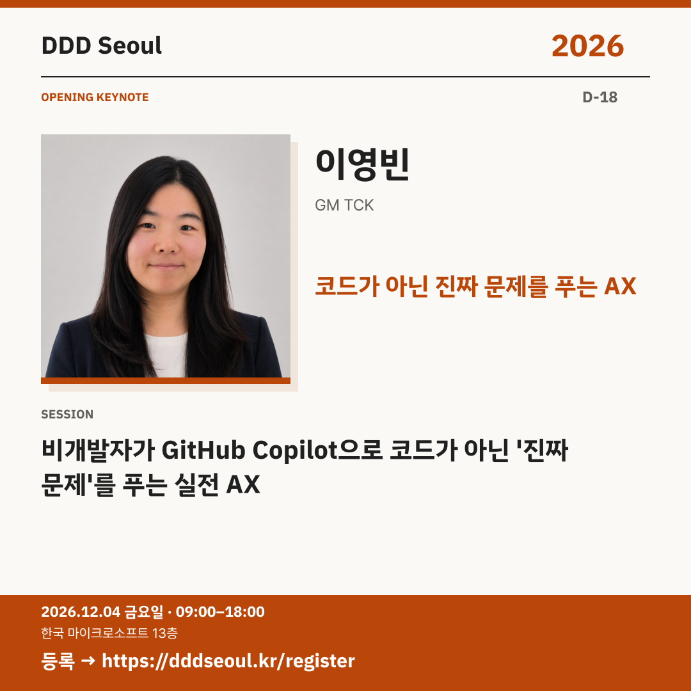

# 2026-11-16 · 코드가 아닌 진짜 문제를 푸는 AX

유형: 발표자 첫 소개 · D-18 · 게시 기준: KST

편집 원본: [SVG](../editable/2026-11-16.svg)

## 이미지 대체 텍스트

DDD Seoul 2026. 코드가 아닌 진짜 문제를 푸는 AX. 이영빈: 비개발자가 GitHub Copilot으로 코드가 아닌 '진짜 문제'를 푸는 실전 AX. 2026년 12월 4일 금요일 09:00–18:00, 한국 마이크로소프트 13층. 등록: https://dddseoul.kr/register

## LinkedIn · 공식 계정

코드를 쓰지 않던 팀장이 팀 AI 비서를 만들었다면?

이영빈 님은 VS Code와 GitHub Copilot으로 팀 AI 비서 ‘Sean’을 만들어 10개월째 함께 일하고 있습니다. 새 서버 없이 instructions·prompts·skills와 SharePoint 동기화 폴더로 팀 전원이 쓰는 비서를 만든 과정, 옆 팀에 확산하려다 겪은 실패와 배움을 나눕니다.

이영빈(GM TCK)
「비개발자가 GitHub Copilot으로 코드가 아닌 '진짜 문제'를 푸는 실전 AX」

2026.12.04(금) 09:00–18:00
한국 마이크로소프트 13층

참가 등록: https://dddseoul.kr/register

#DDDSeoul #DDDSeoul2026

## Facebook · 공식 계정

새 서버 없이, 팀 전원이 쓰는 AI 비서를 만들 수 있을까요?

이영빈 님은 VS Code와 GitHub Copilot으로 팀 AI 비서 ‘Sean’을 만들어 10개월째 함께 일하고 있습니다. 새 서버 없이 instructions·prompts·skills와 SharePoint 동기화 폴더로 팀 전원이 쓰는 비서를 만든 과정, 옆 팀에 확산하려다 겪은 실패와 배움을 나눕니다.

이영빈(GM TCK)
「비개발자가 GitHub Copilot으로 코드가 아닌 '진짜 문제'를 푸는 실전 AX」

12월 4일 금요일, 09:00–18:00
한국 마이크로소프트 13층에서 만나요.

참가 등록: https://dddseoul.kr/register

#DDDSeoul #DDDSeoul2026

## X · 공식 계정

이영빈(GM TCK) 키노트: 비개발자가 GitHub Copilot으로 코드가 아닌 ‘진짜 문제’를 푸는 실전 AX. 팀 AI 비서 ‘Sean’의 구축·운영과 확산의 실패에서 얻은 배움을 만납니다.

등록: https://dddseoul.kr/register

#DDDSeoul #DDDSeoul2026

## Threads · 개인 계정

이영빈 님의 키노트 주제가 공개됐어요. 코드를 쓰지 않던 팀장이 Copilot으로 팀 AI 비서 ‘Sean’을 만들고 10개월째 함께 일한 이야기예요. 옆 팀에 확산하려다 겪은 실패와 배움도 나눕니다.

12/4(금), 한국 마이크로소프트 13층에서 함께 이야기 나눠요.
등록: https://dddseoul.kr/register

#DDDSeoul #DDDSeoul2026

## 게시 전 확인

게시 직전 세션·소속·판매 상태를 확인.

X 가중 문자: 218/280 · Threads: 209/500

초안입니다. 실제 게시·예약은 하지 않았습니다.
