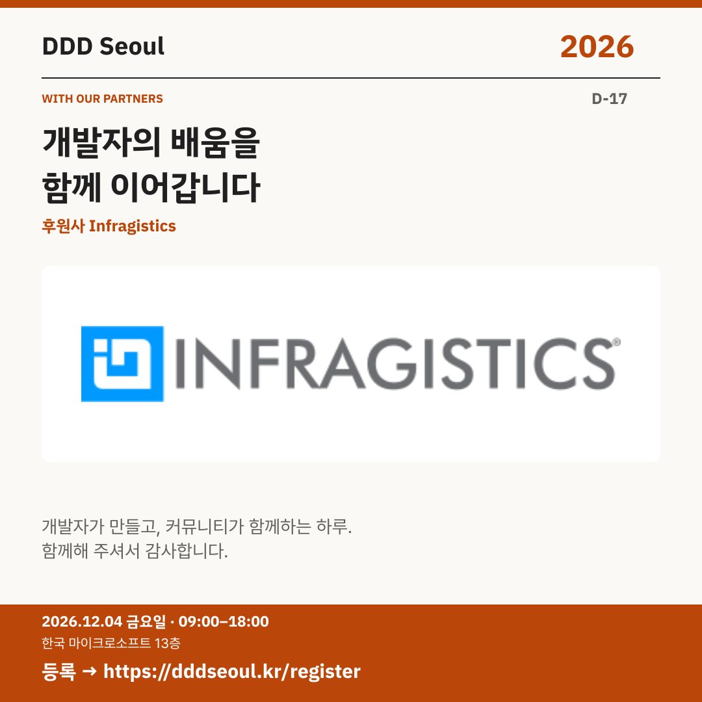

# 2026-11-17 · 개발자의 배움을 함께 이어갑니다

유형: 파트너사 첫 소개 · D-17 · 게시 기준: KST

편집 원본: [SVG](../editable/2026-11-17.svg)

## 이미지 대체 텍스트

DDD Seoul 2026. 개발자의 배움을 함께 이어갑니다. 후원사 Infragistics. 2026년 12월 4일 금요일 09:00–18:00, 한국 마이크로소프트 13층. 등록: https://dddseoul.kr/register

## LinkedIn · 공식 계정

DDD Seoul 2026의 후원사 Infragistics를 소개합니다.

개발자가 주도하고 커뮤니티가 함께하는 행사는 파트너사의 도움으로 이어집니다. DDD Seoul 2026과 함께해 주시는 Infragistics에 감사드립니다.

2026.12.04(금) 09:00–18:00
한국 마이크로소프트 13층

참가 등록: https://dddseoul.kr/register

#DDDSeoul #DDDSeoul2026

## Facebook · 공식 계정

개발자의 배움과 만남을 응원하는 후원사 Infragistics를 소개합니다.

개발자가 주도하고 커뮤니티가 함께하는 행사는 파트너사의 도움으로 이어집니다. DDD Seoul 2026과 함께해 주시는 Infragistics에 감사드립니다.

12월 4일 금요일, 09:00–18:00
한국 마이크로소프트 13층에서 만나요.

참가 등록: https://dddseoul.kr/register

#DDDSeoul #DDDSeoul2026

## X · 공식 계정

DDD Seoul 2026 후원사 Infragistics를 소개합니다. 개발자가 만들고 커뮤니티가 함께하는 하루에 힘을 보태 주셔서 감사합니다.

등록: https://dddseoul.kr/register

#DDDSeoul #DDDSeoul2026

## Threads · 개인 계정

발표자 소개 사이에 감사한 파트너사도 소개해요. Infragistics가 DDD Seoul 2026의 후원사로 함께해 주십니다.

12/4(금), 한국 마이크로소프트 13층에서 함께 이야기 나눠요.
등록: https://dddseoul.kr/register

#DDDSeoul #DDDSeoul2026

## 게시 전 확인

게시 직전 세션·소속·판매 상태를 확인.

X 가중 문자: 176/280 · Threads: 168/500

초안입니다. 실제 게시·예약은 하지 않았습니다.
