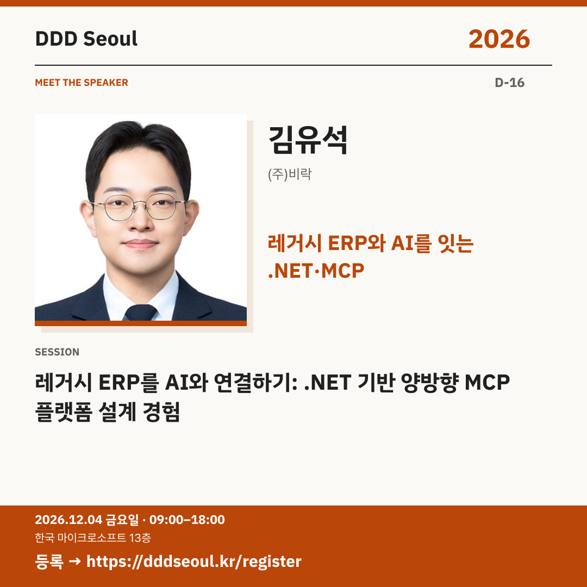

# 2026-11-18 · 레거시 ERP와 AI를 잇는 .NET·MCP

유형: 발표자 첫 소개 · D-16 · 게시 기준: KST

편집 원본: [SVG](../editable/2026-11-18.svg)

## 이미지 대체 텍스트

DDD Seoul 2026. 레거시 ERP와 AI를 잇는 .NET·MCP. 김유석: 레거시 ERP를 AI와 연결하기: .NET 기반 양방향 MCP 플랫폼 설계 경험. 2026년 12월 4일 금요일 09:00–18:00, 한국 마이크로소프트 13층. 등록: https://dddseoul.kr/register

## LinkedIn · 공식 계정

오래된 ERP와 AI, 어떻게 연결할 수 있을까요?

김유석 님은 레거시 ERP를 AI와 연결하는 .NET 기반 양방향 MCP 플랫폼 설계 경험을 공유합니다. 기존 시스템을 AI와 잇는 구조를 고민하는 분들을 위한 세션입니다.

김유석((주)비락)
「레거시 ERP를 AI와 연결하기: .NET 기반 양방향 MCP 플랫폼 설계 경험」

2026.12.04(금) 09:00–18:00
한국 마이크로소프트 13층

참가 등록: https://dddseoul.kr/register

#DDDSeoul #DDDSeoul2026

## Facebook · 공식 계정

새 시스템만이 아니라, 이미 쓰고 있는 ERP에도 AI를 연결하고 싶다면?

김유석 님은 레거시 ERP를 AI와 연결하는 .NET 기반 양방향 MCP 플랫폼 설계 경험을 공유합니다. 기존 시스템을 AI와 잇는 구조를 고민하는 분들을 위한 세션입니다.

김유석((주)비락)
「레거시 ERP를 AI와 연결하기: .NET 기반 양방향 MCP 플랫폼 설계 경험」

12월 4일 금요일, 09:00–18:00
한국 마이크로소프트 13층에서 만나요.

참가 등록: https://dddseoul.kr/register

#DDDSeoul #DDDSeoul2026

## X · 공식 계정

김유석((주)비락)의 “레거시 ERP를 AI와 연결하기”. .NET 기반 양방향 MCP 플랫폼 설계 경험을 DDD Seoul에서 만나세요.

등록: https://dddseoul.kr/register

#DDDSeoul #DDDSeoul2026

## Threads · 개인 계정

새로 만드는 것만큼 기존 시스템과 연결하는 일도 중요하죠. 김유석 님이 레거시 ERP와 AI 사이를 잇는 .NET·MCP 설계 경험을 나눕니다.

12/4(금), 한국 마이크로소프트 13층에서 함께 이야기 나눠요.
등록: https://dddseoul.kr/register

#DDDSeoul #DDDSeoul2026

## 게시 전 확인

게시 직전 세션·소속·판매 상태를 확인.

X 가중 문자: 168/280 · Threads: 177/500

초안입니다. 실제 게시·예약은 하지 않았습니다.
