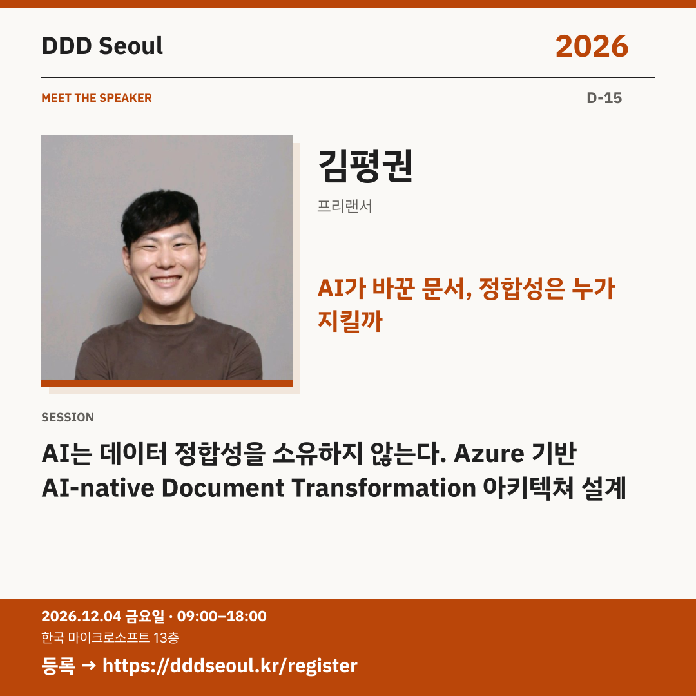

# 2026-11-19 · AI가 바꾼 문서, 정합성은 누가 지킬까

유형: 발표자 첫 소개 · D-15 · 게시 기준: KST

편집 원본: [SVG](../editable/2026-11-19.svg)

## 이미지 대체 텍스트

DDD Seoul 2026. AI가 바꾼 문서, 정합성은 누가 지킬까. 김평권: AI는 데이터 정합성을 소유하지 않는다. Azure 기반 AI-native Document Transformation 아키텍쳐 설계. 2026년 12월 4일 금요일 09:00–18:00, 한국 마이크로소프트 13층. 등록: https://dddseoul.kr/register

## LinkedIn · 공식 계정

AI가 문장을 바꾼 뒤, 문서의 구조와 정합성은 누가 지킬까요?

김평권 님은 Azure 기반 문서 변환 플랫폼의 아키텍처를 소개합니다. AI가 다루는 내용과 시스템이 책임지는 원본 보존·데이터 정합성을 분리하는 설계를 다룹니다.

김평권(프리랜서)
「AI는 데이터 정합성을 소유하지 않는다. Azure 기반 AI-native Document Transformation 아키텍쳐 설계」

2026.12.04(금) 09:00–18:00
한국 마이크로소프트 13층

참가 등록: https://dddseoul.kr/register

#DDDSeoul #DDDSeoul2026

## Facebook · 공식 계정

번역은 됐는데 표와 레이아웃이 깨졌다면, 아키텍처에서 답을 찾아볼까요?

김평권 님은 Azure 기반 문서 변환 플랫폼의 아키텍처를 소개합니다. AI가 다루는 내용과 시스템이 책임지는 원본 보존·데이터 정합성을 분리하는 설계를 다룹니다.

김평권(프리랜서)
「AI는 데이터 정합성을 소유하지 않는다. Azure 기반 AI-native Document Transformation 아키텍쳐 설계」

12월 4일 금요일, 09:00–18:00
한국 마이크로소프트 13층에서 만나요.

참가 등록: https://dddseoul.kr/register

#DDDSeoul #DDDSeoul2026

## X · 공식 계정

AI는 데이터 정합성을 소유하지 않는다. 김평권(프리랜서)이 Azure 기반 문서 변환 아키텍처에서 AI의 역할과 시스템의 책임을 나누는 방법을 소개합니다.

등록: https://dddseoul.kr/register

#DDDSeoul #DDDSeoul2026

## Threads · 개인 계정

AI가 내용을 잘 바꿔도 원본 구조까지 잘 지킨다는 뜻은 아니겠죠. 김평권 님이 문서 변환과 데이터 정합성을 함께 설계한 이야기를 소개해요.

12/4(금), 한국 마이크로소프트 13층에서 함께 이야기 나눠요.
등록: https://dddseoul.kr/register

#DDDSeoul #DDDSeoul2026

## 게시 전 확인

게시 직전 세션·소속·판매 상태를 확인.

X 가중 문자: 200/280 · Threads: 175/500

초안입니다. 실제 게시·예약은 하지 않았습니다.
