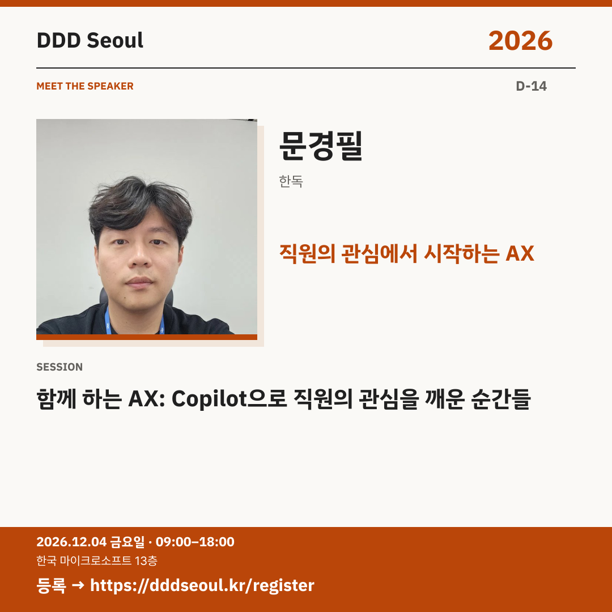

# 2026-11-20 · 직원의 관심에서 시작하는 AX

유형: 발표자 첫 소개 · D-14 · 게시 기준: KST

편집 원본: [SVG](../editable/2026-11-20.svg)

## 이미지 대체 텍스트

DDD Seoul 2026. 직원의 관심에서 시작하는 AX. 문경필: 함께 하는 AX: Copilot으로 직원의 관심을 깨운 순간들. 2026년 12월 4일 금요일 09:00–18:00, 한국 마이크로소프트 13층. 등록: https://dddseoul.kr/register

## LinkedIn · 공식 계정

AX를 ‘제출할 과제’에서 ‘내 역량을 키우는 일’로 바꾸려면?

문경필 님은 업무에 맞는 Microsoft 365와 Copilot 멘토링 사례를 공유합니다. 직원의 관심을 깨우고 지속시키며 함께 만들어 가는 AX의 방법을 살펴봅니다.

문경필(한독)
「함께 하는 AX: Copilot으로 직원의 관심을 깨운 순간들」

2026.12.04(금) 09:00–18:00
한국 마이크로소프트 13층

참가 등록: https://dddseoul.kr/register

#DDDSeoul #DDDSeoul2026

## Facebook · 공식 계정

회사에서 시켜서 하는 AX가 아니라, 직원이 관심을 갖는 AX는 어떻게 만들까요?

문경필 님은 업무에 맞는 Microsoft 365와 Copilot 멘토링 사례를 공유합니다. 직원의 관심을 깨우고 지속시키며 함께 만들어 가는 AX의 방법을 살펴봅니다.

문경필(한독)
「함께 하는 AX: Copilot으로 직원의 관심을 깨운 순간들」

12월 4일 금요일, 09:00–18:00
한국 마이크로소프트 13층에서 만나요.

참가 등록: https://dddseoul.kr/register

#DDDSeoul #DDDSeoul2026

## X · 공식 계정

문경필(한독)의 “함께 하는 AX”. Microsoft 365·Copilot 멘토링을 통해 직원의 관심을 깨우고, 업무와 역량으로 연결한 순간들을 함께 살펴보세요.

등록: https://dddseoul.kr/register

#DDDSeoul #DDDSeoul2026

## Threads · 개인 계정

도구를 소개하는 것과 실제로 관심을 끌어내는 건 다른 일이겠죠. 문경필 님이 Copilot 멘토링에서 만난 전환의 순간들을 나눕니다.

12/4(금), 한국 마이크로소프트 13층에서 함께 이야기 나눠요.
등록: https://dddseoul.kr/register

#DDDSeoul #DDDSeoul2026

## 게시 전 확인

게시 직전 세션·소속·판매 상태를 확인.

X 가중 문자: 193/280 · Threads: 171/500

초안입니다. 실제 게시·예약은 하지 않았습니다.
