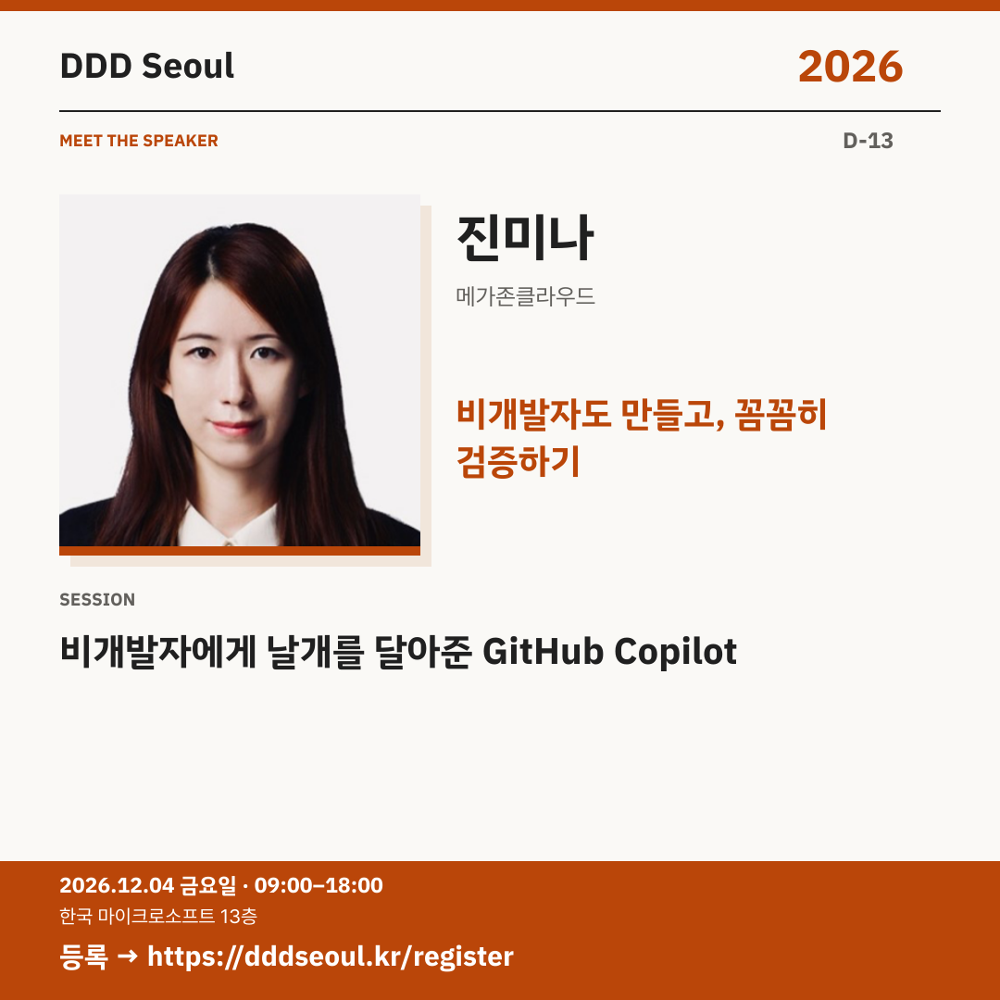

# 2026-11-21 · 비개발자도 만들고, 꼼꼼히 검증하기

유형: 발표자 첫 소개 · D-13 · 게시 기준: KST

편집 원본: [SVG](../editable/2026-11-21.svg)

## 이미지 대체 텍스트

DDD Seoul 2026. 비개발자도 만들고, 꼼꼼히 검증하기. 진미나: 비개발자에게 날개를 달아준 GitHub Copilot. 2026년 12월 4일 금요일 09:00–18:00, 한국 마이크로소프트 13층. 등록: https://dddseoul.kr/register

## LinkedIn · 공식 계정

코딩을 몰라도 만들 수 있다면, 제대로 만들었는지는 어떻게 확인할까요?

진미나 님은 GitHub Copilot으로 아이디어를 작동하는 결과물로 만드는 과정과 검증·테스트를 함께 다룹니다. 비개발자의 시선으로 만들기와 확인하기를 이어가는 경험을 공유합니다.

진미나(메가존클라우드)
「비개발자에게 날개를 달아준 GitHub Copilot」

2026.12.04(금) 09:00–18:00
한국 마이크로소프트 13층

참가 등록: https://dddseoul.kr/register

#DDDSeoul #DDDSeoul2026

## Facebook · 공식 계정

AI가 만들어준 화면이 잘 뜬다고, 모든 게 괜찮은 걸까요?

진미나 님은 GitHub Copilot으로 아이디어를 작동하는 결과물로 만드는 과정과 검증·테스트를 함께 다룹니다. 비개발자의 시선으로 만들기와 확인하기를 이어가는 경험을 공유합니다.

진미나(메가존클라우드)
「비개발자에게 날개를 달아준 GitHub Copilot」

12월 4일 금요일, 09:00–18:00
한국 마이크로소프트 13층에서 만나요.

참가 등록: https://dddseoul.kr/register

#DDDSeoul #DDDSeoul2026

## X · 공식 계정

“비개발자에게 날개를 달아준 GitHub Copilot” — 진미나(메가존클라우드). 아이디어를 직접 만들고, 놓치기 쉬운 함정을 검증·테스트하는 과정까지!

등록: https://dddseoul.kr/register

#DDDSeoul #DDDSeoul2026

## Threads · 개인 계정

만들 수 있게 된 다음에는 확인하는 방법도 필요하겠죠. 진미나 님이 비개발자의 시선에서 GitHub Copilot으로 만들고 검증하는 이야기를 나눕니다.

12/4(금), 한국 마이크로소프트 13층에서 함께 이야기 나눠요.
등록: https://dddseoul.kr/register

#DDDSeoul #DDDSeoul2026

## 게시 전 확인

게시 직전 세션·소속·판매 상태를 확인.

X 가중 문자: 194/280 · Threads: 182/500

초안입니다. 실제 게시·예약은 하지 않았습니다.
