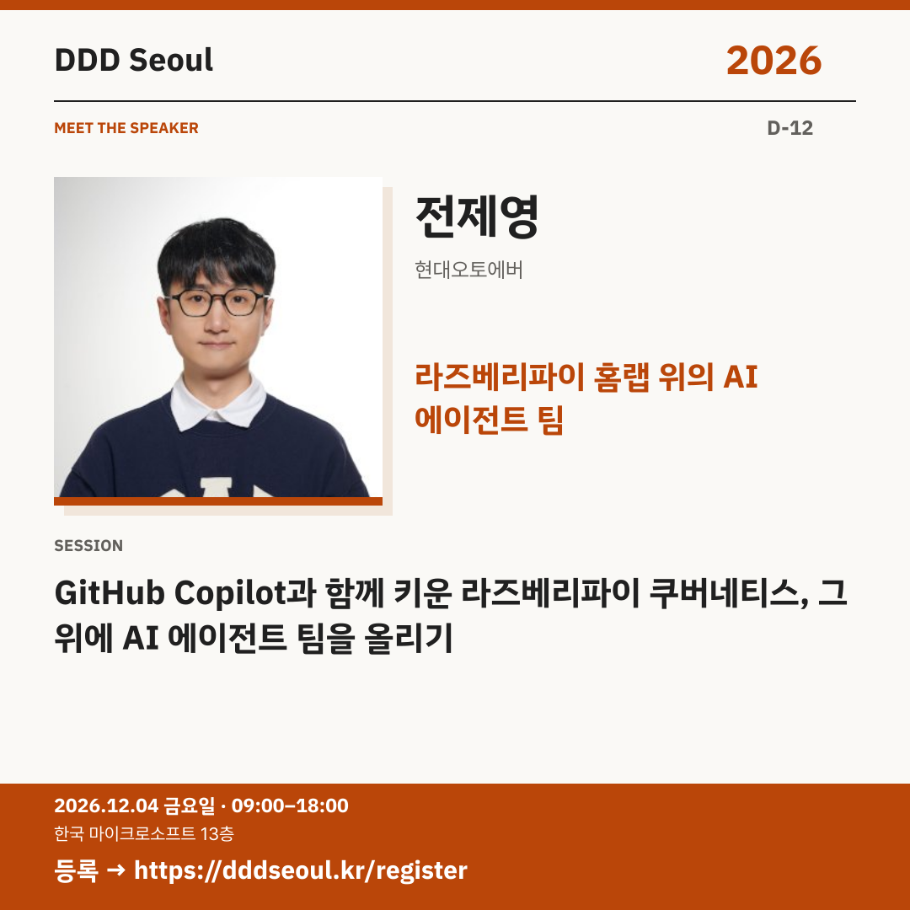

# 2026-11-22 · 라즈베리파이 홈랩 위의 AI 에이전트 팀

유형: 발표자 첫 소개 · D-12 · 게시 기준: KST

편집 원본: [SVG](../editable/2026-11-22.svg)

## 이미지 대체 텍스트

DDD Seoul 2026. 라즈베리파이 홈랩 위의 AI 에이전트 팀. 전제영: GitHub Copilot과 함께 키운 라즈베리파이 쿠버네티스, 그 위에 AI 에이전트 팀을 올리기. 2026년 12월 4일 금요일 09:00–18:00, 한국 마이크로소프트 13층. 등록: https://dddseoul.kr/register

## LinkedIn · 공식 계정

취미로 키운 라즈베리파이 홈랩이 AI 에이전트 팀의 플랫폼이 된다면?

전제영 님은 GitHub Copilot으로 가꾼 Kubernetes 홈랩과 Hermes Agent 팀을 소개합니다. GitOps·CI/CD 러너, 팬 제어기 pifanctl과 클러스터를 살피는 에이전트 Hana의 데모, 에이전트 간 무한 호출 등 실패에서 얻은 운영 규칙과 실무 활용 경험을 나눕니다.

전제영(현대오토에버)
「GitHub Copilot과 함께 키운 라즈베리파이 쿠버네티스, 그 위에 AI 에이전트 팀을 올리기」

2026.12.04(금) 09:00–18:00
한국 마이크로소프트 13층

참가 등록: https://dddseoul.kr/register

#DDDSeoul #DDDSeoul2026

## Facebook · 공식 계정

작은 라즈베리파이에서 시작한 프로젝트가 어디까지 자랄 수 있을까요?

전제영 님은 GitHub Copilot으로 가꾼 Kubernetes 홈랩과 Hermes Agent 팀을 소개합니다. GitOps·CI/CD 러너, 팬 제어기 pifanctl과 클러스터를 살피는 에이전트 Hana의 데모, 에이전트 간 무한 호출 등 실패에서 얻은 운영 규칙과 실무 활용 경험을 나눕니다.

전제영(현대오토에버)
「GitHub Copilot과 함께 키운 라즈베리파이 쿠버네티스, 그 위에 AI 에이전트 팀을 올리기」

12월 4일 금요일, 09:00–18:00
한국 마이크로소프트 13층에서 만나요.

참가 등록: https://dddseoul.kr/register

#DDDSeoul #DDDSeoul2026

## X · 공식 계정

전제영(현대오토에버)의 라즈베리파이 Kubernetes와 AI 에이전트 팀! GitOps·CI/CD, 팬 제어기 pifanctl과 에이전트 Hana의 운영 데모, 실패에서 얻은 규칙을 만나세요.

등록: https://dddseoul.kr/register

#DDDSeoul #DDDSeoul2026

## Threads · 개인 계정

전제영 님의 라즈베리파이 홈랩에서는 에이전트 Hana가 팬과 클러스터 상태를 살피고 먼저 알려준대요. Copilot으로 꾸린 에이전트 팀의 데모와 무한 호출 같은 실패에서 얻은 운영 규칙도 함께 나눕니다.

12/4(금), 한국 마이크로소프트 13층에서 함께 이야기 나눠요.
등록: https://dddseoul.kr/register

#DDDSeoul #DDDSeoul2026

## 게시 전 확인

게시 직전 세션·소속·판매 상태를 확인.

X 가중 문자: 213/280 · Threads: 211/500

초안입니다. 실제 게시·예약은 하지 않았습니다.
