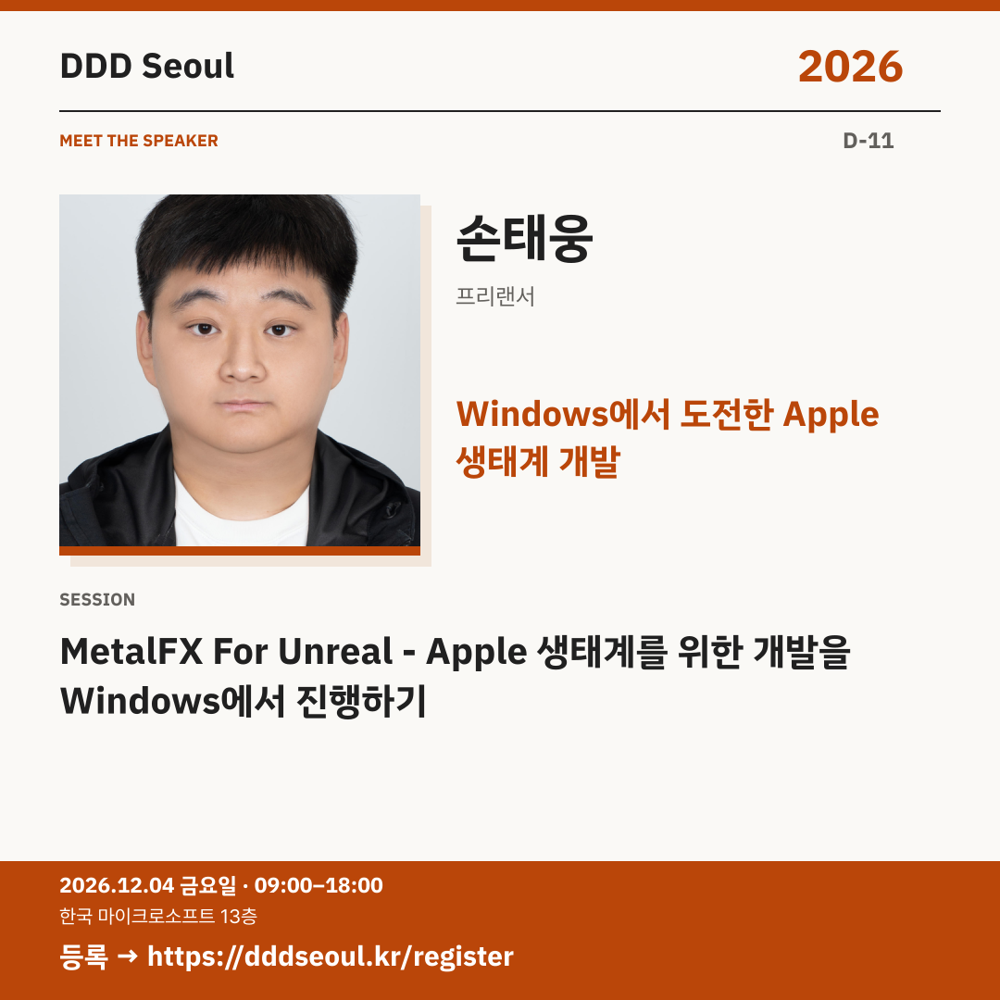

# 2026-11-23 · Windows에서 도전한 Apple 생태계 개발

유형: 발표자 첫 소개 · D-11 · 게시 기준: KST

편집 원본: [SVG](../editable/2026-11-23.svg)

## 이미지 대체 텍스트

DDD Seoul 2026. Windows에서 도전한 Apple 생태계 개발. 손태웅: MetalFX For Unreal - Apple 생태계를 위한 개발을 Windows에서 진행하기. 2026년 12월 4일 금요일 09:00–18:00, 한국 마이크로소프트 13층. 등록: https://dddseoul.kr/register

## LinkedIn · 공식 계정

개발 환경의 제약이 새로운 도전의 출발점이 될 수 있을까요?

손태웅 님은 Windows와 Mac 환경을 오가며 Apple 생태계 전용 Temporal Upscaling을 개발한 경험을 공유합니다. MetalFX For Unreal 개발 현황과 제한된 환경에서의 도전을 만나보세요.

손태웅(프리랜서)
「MetalFX For Unreal - Apple 생태계를 위한 개발을 Windows에서 진행하기」

2026.12.04(금) 09:00–18:00
한국 마이크로소프트 13층

참가 등록: https://dddseoul.kr/register

#DDDSeoul #DDDSeoul2026

## Facebook · 공식 계정

Windows에서 Apple 생태계를 위한 개발에 도전한다면?

손태웅 님은 Windows와 Mac 환경을 오가며 Apple 생태계 전용 Temporal Upscaling을 개발한 경험을 공유합니다. MetalFX For Unreal 개발 현황과 제한된 환경에서의 도전을 만나보세요.

손태웅(프리랜서)
「MetalFX For Unreal - Apple 생태계를 위한 개발을 Windows에서 진행하기」

12월 4일 금요일, 09:00–18:00
한국 마이크로소프트 13층에서 만나요.

참가 등록: https://dddseoul.kr/register

#DDDSeoul #DDDSeoul2026

## X · 공식 계정

MetalFX For Unreal — Apple 생태계를 위한 개발을 Windows에서! 손태웅(프리랜서)이 Windows·Mac을 오가며 Temporal Upscaling을 개발한 경험을 공유합니다.

등록: https://dddseoul.kr/register

#DDDSeoul #DDDSeoul2026

## Threads · 개인 계정

익숙한 환경 밖으로 나가야 할 때의 개발 이야기도 준비돼 있어요. 손태웅 님이 Windows와 Mac을 오가며 진행한 MetalFX For Unreal 개발기를 나눕니다.

12/4(금), 한국 마이크로소프트 13층에서 함께 이야기 나눠요.
등록: https://dddseoul.kr/register

#DDDSeoul #DDDSeoul2026

## 게시 전 확인

게시 직전 세션·소속·판매 상태를 확인.

X 가중 문자: 203/280 · Threads: 192/500

초안입니다. 실제 게시·예약은 하지 않았습니다.
