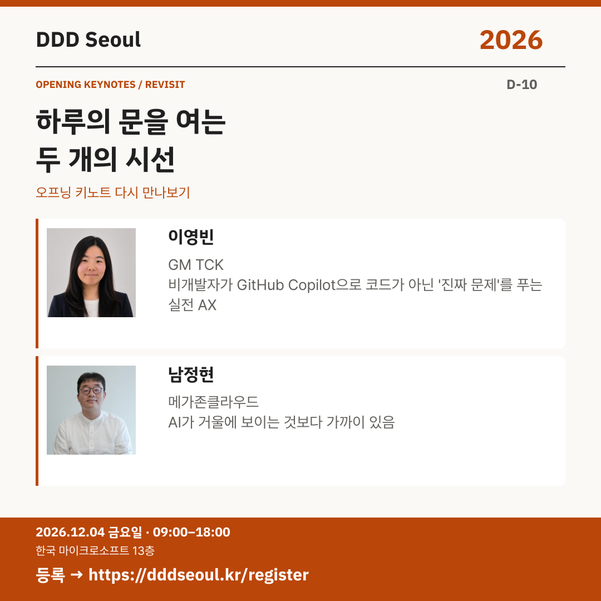

# 2026-11-24 · 하루의 문을 여는 두 개의 시선

유형: 키노트 재소개 · D-10 · 게시 기준: KST

편집 원본: [SVG](../editable/2026-11-24.svg)

## 이미지 대체 텍스트

DDD Seoul 2026. 하루의 문을 여는 두 개의 시선. 이영빈: 비개발자가 GitHub Copilot으로 코드가 아닌 '진짜 문제'를 푸는 실전 AX / 남정현: AI가 거울에 보이는 것보다 가까이 있음. 2026년 12월 4일 금요일 09:00–18:00, 한국 마이크로소프트 13층. 등록: https://dddseoul.kr/register

## LinkedIn · 공식 계정

발표자 소개를 모두 마쳤습니다. 오늘부터 주제별로 다시 살펴봅니다. 첫 순서는 오프닝 키노트입니다.

이영빈 님은 비개발자가 GitHub Copilot으로 팀 AI 비서 ‘Sean’을 만들고 진짜 문제를 푼 실전 AX를 나눕니다. 남정현 님은 AI 시대에도 더 중요해지는 소프트웨어와 개발자의 가치를 이야기합니다. 두 연사와 함께 하루를 시작하세요.

이영빈(GM TCK)
「비개발자가 GitHub Copilot으로 코드가 아닌 '진짜 문제'를 푸는 실전 AX」

남정현(메가존클라우드)
「AI가 거울에 보이는 것보다 가까이 있음」

2026.12.04(금) 09:00–18:00
한국 마이크로소프트 13층

참가 등록: https://dddseoul.kr/register

#DDDSeoul #DDDSeoul2026

## Facebook · 공식 계정

모든 발표자를 만나봤으니, 이제 오프닝 키노트 두 분을 함께 살펴볼까요?

이영빈 님은 비개발자가 GitHub Copilot으로 팀 AI 비서 ‘Sean’을 만들고 진짜 문제를 푼 실전 AX를 나눕니다. 남정현 님은 AI 시대에도 더 중요해지는 소프트웨어와 개발자의 가치를 이야기합니다. 두 연사와 함께 하루를 시작하세요.

이영빈(GM TCK)
「비개발자가 GitHub Copilot으로 코드가 아닌 '진짜 문제'를 푸는 실전 AX」

남정현(메가존클라우드)
「AI가 거울에 보이는 것보다 가까이 있음」

12월 4일 금요일, 09:00–18:00
한국 마이크로소프트 13층에서 만나요.

참가 등록: https://dddseoul.kr/register

#DDDSeoul #DDDSeoul2026

## X · 공식 계정

오프닝 키노트 다시 보기: 이영빈(GM TCK) — Copilot으로 팀 AI 비서 ‘Sean’을 만든 실전 AX / 남정현(메가존클라우드) — “AI가 거울에 보이는 것보다 가까이 있음”.

등록: https://dddseoul.kr/register

#DDDSeoul #DDDSeoul2026

## Threads · 개인 계정

오늘부터는 발표자들을 주제별로 다시 소개해요. 이영빈 님의 Copilot 팀 AI 비서 ‘Sean’과 실전 AX, 남정현 님의 코드와 경험의 가치 이야기로 하루를 시작해봐요.

12/4(금), 한국 마이크로소프트 13층에서 함께 이야기 나눠요.
등록: https://dddseoul.kr/register

#DDDSeoul #DDDSeoul2026

## 게시 전 확인

게시 직전 세션·소속·판매 상태를 확인.

X 가중 문자: 210/280 · Threads: 194/500

초안입니다. 실제 게시·예약은 하지 않았습니다.
