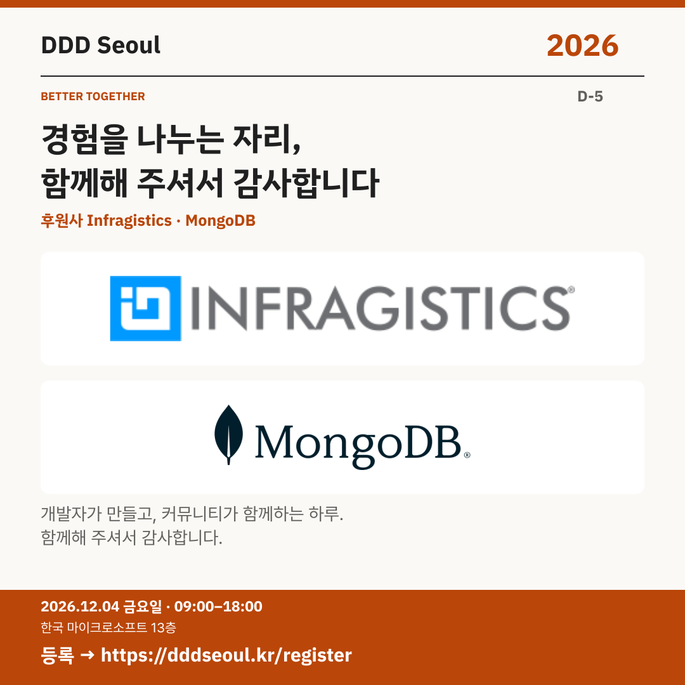

# 2026-11-29 · 경험을 나누는 자리, 함께해 주셔서 감사합니다

유형: 파트너사 재소개 · D-5 · 게시 기준: KST

편집 원본: [SVG](../editable/2026-11-29.svg)

## 이미지 대체 텍스트

DDD Seoul 2026. 경험을 나누는 자리, 함께해 주셔서 감사합니다. 후원사 Infragistics, 후원사 MongoDB. 2026년 12월 4일 금요일 09:00–18:00, 한국 마이크로소프트 13층. 등록: https://dddseoul.kr/register

## LinkedIn · 공식 계정

DDD Seoul 2026의 후원사 Infragistics와 MongoDB에 감사드립니다.

커뮤니티가 주도하는 개발자 컨퍼런스에 두 파트너사가 함께합니다. 각자의 현장 경험이 모이는 자리에 여러분도 함께해 주세요.

2026.12.04(금) 09:00–18:00
한국 마이크로소프트 13층

참가 등록: https://dddseoul.kr/register

#DDDSeoul #DDDSeoul2026

## Facebook · 공식 계정

Infragistics와 MongoDB가 함께 응원하는 DDD Seoul 2026, 여러분도 만나러 오세요.

커뮤니티가 주도하는 개발자 컨퍼런스에 두 파트너사가 함께합니다. 각자의 현장 경험이 모이는 자리에 여러분도 함께해 주세요.

12월 4일 금요일, 09:00–18:00
한국 마이크로소프트 13층에서 만나요.

참가 등록: https://dddseoul.kr/register

#DDDSeoul #DDDSeoul2026

## X · 공식 계정

DDD Seoul 2026 후원사 Infragistics·MongoDB에 감사드립니다. 개발자의 경험과 배움을 함께 나누는 자리에 여러분을 초대합니다.

등록: https://dddseoul.kr/register

#DDDSeoul #DDDSeoul2026

## Threads · 개인 계정

오늘은 후원사 Infragistics와 MongoDB에 감사 인사를 전해요. 많은 분들의 도움으로 만드는 행사인 만큼, 경험을 나누는 좋은 자리로 준비하고 있어요.

12/4(금), 한국 마이크로소프트 13층에서 함께 이야기 나눠요.
등록: https://dddseoul.kr/register

#DDDSeoul #DDDSeoul2026

## 게시 전 확인

게시 직전 세션·소속·판매 상태를 확인.

X 가중 문자: 177/280 · Threads: 188/500

초안입니다. 실제 게시·예약은 하지 않았습니다.
