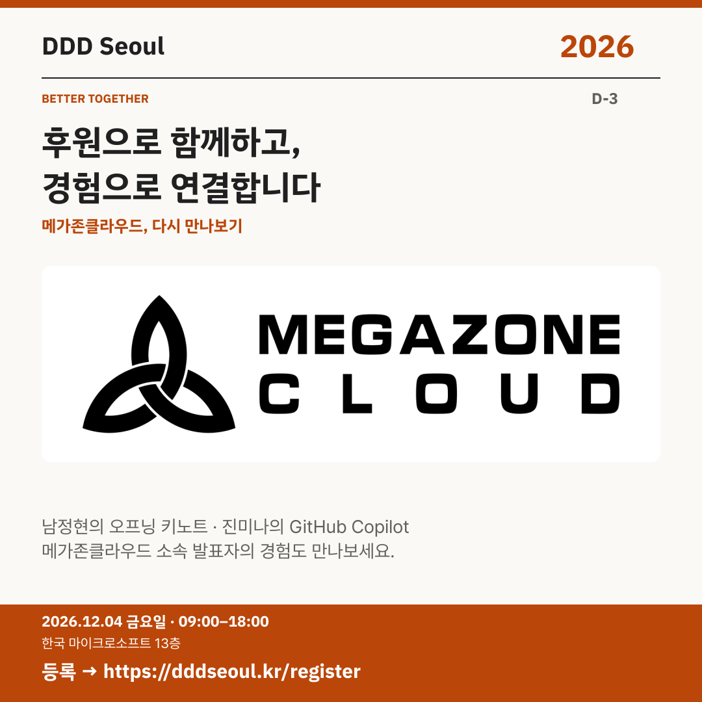

# 2026-12-01 · 후원으로 함께하고, 경험으로 연결합니다

유형: 파트너사 재소개 · D-3 · 게시 기준: KST

편집 원본: [SVG](../editable/2026-12-01.svg)

## 이미지 대체 텍스트

DDD Seoul 2026. 후원으로 함께하고, 경험으로 연결합니다. 주 후원사 메가존클라우드. 2026년 12월 4일 금요일 09:00–18:00, 한국 마이크로소프트 13층. 등록: https://dddseoul.kr/register

## LinkedIn · 공식 계정

주 후원사 메가존클라우드에 다시 감사드리며, 소속 발표자들의 세션도 연결해 소개합니다.

남정현 님은 오프닝 키노트 ‘AI가 거울에 보이는 것보다 가까이 있음’을, 진미나 님은 ‘비개발자에게 날개를 달아준 GitHub Copilot’을 발표합니다. 후원과 각 발표자의 경험이 함께하는 자리를 만나보세요.

2026.12.04(금) 09:00–18:00
한국 마이크로소프트 13층

참가 등록: https://dddseoul.kr/register

#DDDSeoul #DDDSeoul2026

## Facebook · 공식 계정

메가존클라우드에 감사드리며 남정현·진미나 님의 발표도 다시 소개합니다.

남정현 님은 오프닝 키노트 ‘AI가 거울에 보이는 것보다 가까이 있음’을, 진미나 님은 ‘비개발자에게 날개를 달아준 GitHub Copilot’을 발표합니다. 후원과 각 발표자의 경험이 함께하는 자리를 만나보세요.

12월 4일 금요일, 09:00–18:00
한국 마이크로소프트 13층에서 만나요.

참가 등록: https://dddseoul.kr/register

#DDDSeoul #DDDSeoul2026

## X · 공식 계정

주 후원사 메가존클라우드, 다시 만나보기. 남정현의 AI 시대 개발자 가치 키노트와 진미나의 비개발자 GitHub Copilot 활용·검증 세션도 함께 살펴보세요.

등록: https://dddseoul.kr/register

#DDDSeoul #DDDSeoul2026

## Threads · 개인 계정

주 후원사 메가존클라우드에는 남정현·진미나 님이 소속돼 있어요. 두 분이 나눌 키노트와 GitHub Copilot 경험도 함께 살펴봐 주세요. 행사에 함께해 주셔서 감사합니다.

12/4(금), 한국 마이크로소프트 13층에서 함께 이야기 나눠요.
등록: https://dddseoul.kr/register

#DDDSeoul #DDDSeoul2026

## 게시 전 확인

게시 직전 세션·소속·판매 상태를 확인.

X 가중 문자: 201/280 · Threads: 195/500

초안입니다. 실제 게시·예약은 하지 않았습니다.
