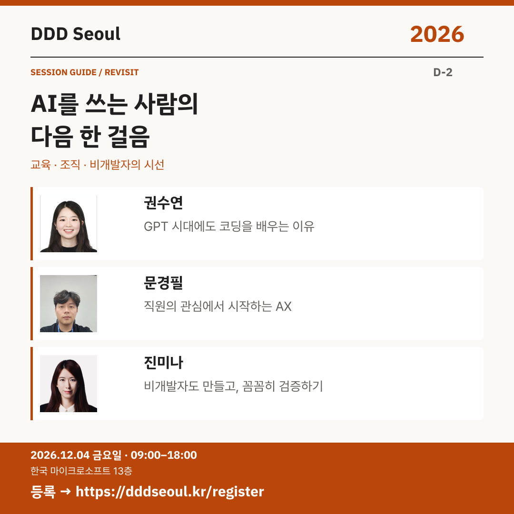

# 2026-12-02 · AI를 쓰는 사람의 다음 한 걸음

유형: 일반 세션 재소개 · D-2 · 게시 기준: KST

편집 원본: [SVG](../editable/2026-12-02.svg)

## 이미지 대체 텍스트

DDD Seoul 2026. AI를 쓰는 사람의 다음 한 걸음. 권수연: 쌤, GPT가 다 해주는데 코딩 왜 배워야 해요? (부제 : 야생의 아이들과 함께 자라기) / 문경필: 함께 하는 AX: Copilot으로 직원의 관심을 깨운 순간들 / 진미나: 비개발자에게 날개를 달아준 GitHub Copilot. 2026년 12월 4일 금요일 09:00–18:00, 한국 마이크로소프트 13층. 등록: https://dddseoul.kr/register

## LinkedIn · 공식 계정

DDD Seoul 2026까지 이틀. 기술을 사용하는 사람의 변화에도 주목해 보세요.

권수연 님은 회사와 코딩 교실의 경험을, 문경필 님은 직원의 관심을 깨우는 AX를, 진미나 님은 비개발자가 Copilot으로 만들고 검증하는 과정을 공유합니다.

권수연(바이브컴퍼니)
「쌤, GPT가 다 해주는데 코딩 왜 배워야 해요? (부제 : 야생의 아이들과 함께 자라기)」

문경필(한독)
「함께 하는 AX: Copilot으로 직원의 관심을 깨운 순간들」

진미나(메가존클라우드)
「비개발자에게 날개를 달아준 GitHub Copilot」

2026.12.04(금) 09:00–18:00
한국 마이크로소프트 13층

참가 등록: https://dddseoul.kr/register

#DDDSeoul #DDDSeoul2026

## Facebook · 공식 계정

AI를 어떻게 쓰느냐만큼, 누가 어떻게 배우고 달라지는지도 중요하죠.

권수연 님은 회사와 코딩 교실의 경험을, 문경필 님은 직원의 관심을 깨우는 AX를, 진미나 님은 비개발자가 Copilot으로 만들고 검증하는 과정을 공유합니다.

권수연(바이브컴퍼니)
「쌤, GPT가 다 해주는데 코딩 왜 배워야 해요? (부제 : 야생의 아이들과 함께 자라기)」

문경필(한독)
「함께 하는 AX: Copilot으로 직원의 관심을 깨운 순간들」

진미나(메가존클라우드)
「비개발자에게 날개를 달아준 GitHub Copilot」

12월 4일 금요일, 09:00–18:00
한국 마이크로소프트 13층에서 만나요.

참가 등록: https://dddseoul.kr/register

#DDDSeoul #DDDSeoul2026

## X · 공식 계정

D-2, AI를 쓰는 사람의 변화: 권수연 — 코딩 교육 / 문경필 — 직원의 관심을 깨우는 AX / 진미나 — 비개발자의 Copilot 활용·검증. 12/4에 만나요.

등록: https://dddseoul.kr/register

#DDDSeoul #DDDSeoul2026

## Threads · 개인 계정

이제 행사까지 이틀이에요. 권수연·문경필·진미나 님은 교육, 조직의 AX, 비개발자의 만들기와 검증을 이야기합니다. 기술을 쓰는 사람의 변화도 함께 들어봐요.

12/4(금), 한국 마이크로소프트 13층에서 함께 이야기 나눠요.
등록: https://dddseoul.kr/register

#DDDSeoul #DDDSeoul2026

## 게시 전 확인

게시 직전 세션·소속·판매 상태를 확인.

X 가중 문자: 193/280 · Threads: 185/500

초안입니다. 실제 게시·예약은 하지 않았습니다.
